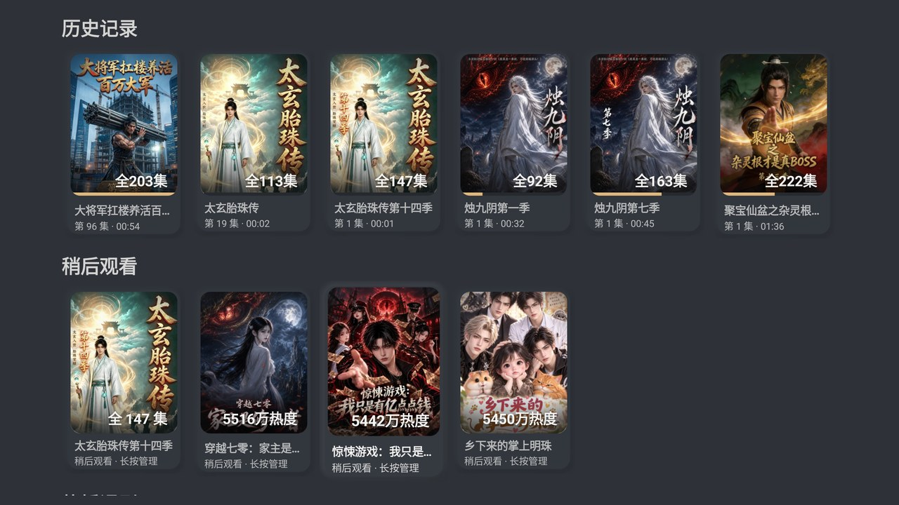
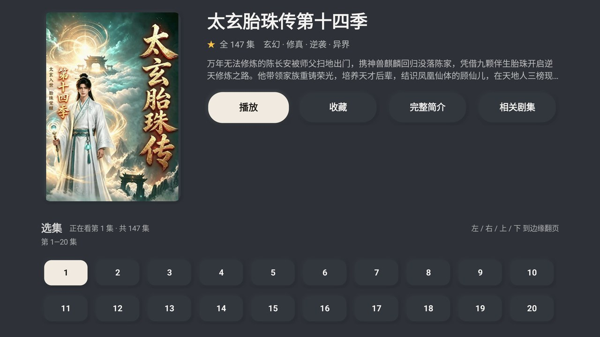
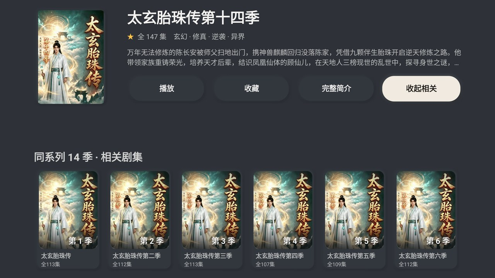
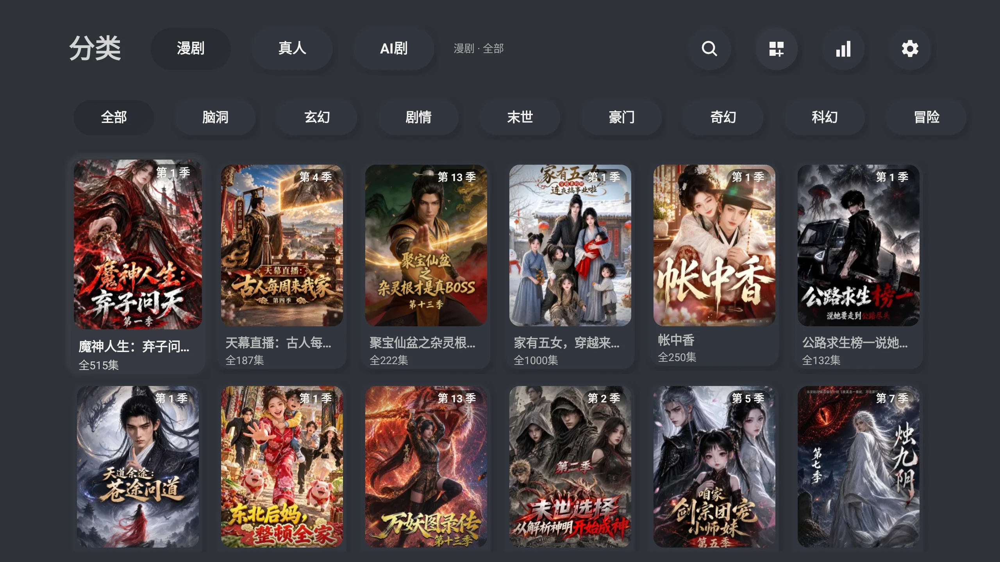
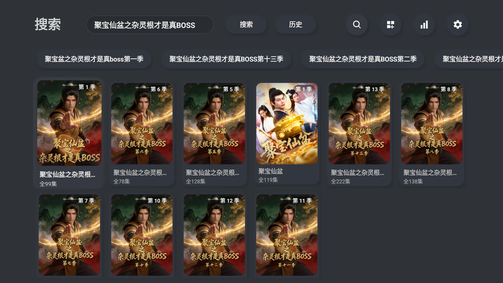
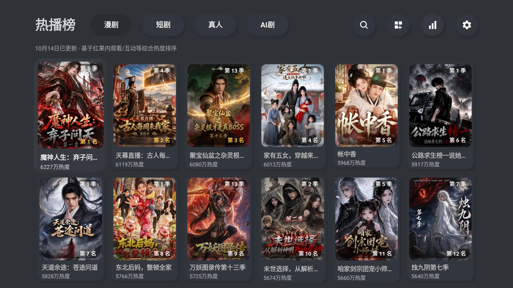
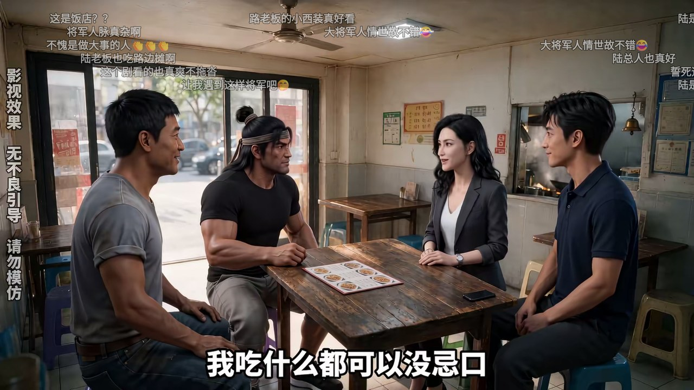
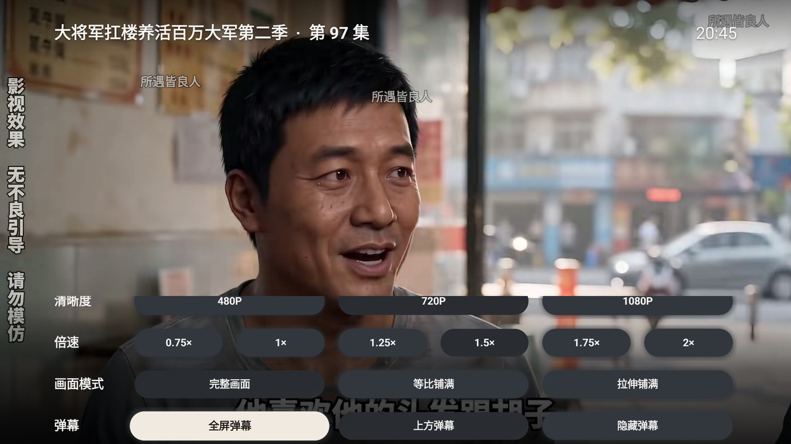
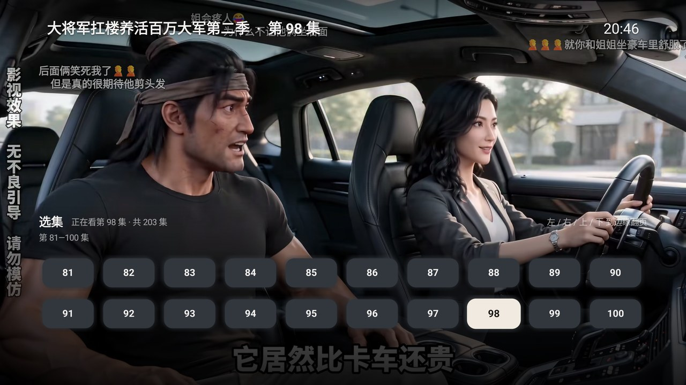

<p align="center"></p>

# HGTV（Android TV / 手机 / 平板，4.4+）

短剧客户端：单 APK、Kotlin + ExoPlayer，电视用遥控器、手机平板用触屏，装好联网即可看；不登录也能浏览播放，登录只用来同步云端收藏、历史与预约。

## 目录

- [功能](#功能)
- [界面](#界面)
- [下载](#下载)
- [当前限制](#当前限制)
- [工程结构](#工程结构)
- [开发](#开发)
- [维护者](#维护者)
- [参与贡献](#参与贡献)
- [交流](#交流)

## 功能

- **浏览**：首页分区剧架、榜单（多榜单）、分类页（大类 / 小类），长列表右下角有「回到顶部」。
- **推荐**：打开应用可直接进推荐页，上下换剧、左右快进、按确定看正片；进度条与正式播放一致，可拖动。
- **搜索**：关键词搜索，候选词横向滚动行，结果向下自动加载；搜索源可切 App / 官网，也可扫码用手机输入。
- **收藏与记录**：本机收藏、最近观看、稍后看，支持断点续播与「继续观看」直达；历史可按已看完 / 未看完筛选、可一键清空；卡片长按或按菜单键可收藏 / 稍后看 / 隐藏推荐 / 删除记录。
- **登录**：「我的」页扫码或手机号 + 验证码两种登录，二维码过期自动刷新，登录后可退出或刷新；进入我的页先看第三方客户端使用须知，取验证码前每次确认。
- **重装恢复**：卸载重装后自动恢复登录与设备身份，不用重新注册、重新收验证码。
- **预约**：显示上线时间，可按已上线 / 待上线筛选；详情页列出相关剧集。
- **选集**：详情页与播放器内同一套选集网格，按页翻看。
- **播放**：480P / 720P / 1080P 上限、0.75–2× 倍速、三种画面模式、画面缩放 1–100%、自动连播；左右滑动调进度，进度条可拖动，画面上可常显剧名 / 剧集 / 网速 / 时间。
- **视频解码**：硬件解码（默认，省电、4K 更稳）与软件解码（兼容性好，花屏 / 绿屏 / 音画不同步时用）可切换。
- **按键自定义**：播放界面的上下左右 / 菜单 / 确定键各做什么可改，支持一键恢复默认。
- **弹幕**：全屏 / 上方 / 隐藏三档，表情标签还原成表情图；速度可调、相同弹幕可聚合，字号与透明度可调。
- **定时停止**：按分钟或按集数到点暂停并保存进度。
- **播完推荐**：一集播完自动接下一集，全剧播完后推荐下一部。
- **手机辅助**：扫码在手机上输入搜索词、手机备份与恢复本机记录（局域网，用完即关）。
- **界面**：20 套材质主题、每行卡片可选 4–8 张、功能显示开关（导航入口 / 首页栏目 / 播放信息各自可关）、减少动画优化性能、使用设备（手机 / 平板 / 电视）、短剧自动全屏；手机与平板可点按操作，平板点画面出控制条。
- **设置**：偏好自动保存；可查看开源许可、打开调试模式（页面角落常驻现场面板与性能信息）、清空应用缓存（恢复出厂）。

## 界面

新拟态（Neumorphism）风格：全站只有一块材质，层次由「凸起 / 凹陷」与柔光表达；
播放界面不套新拟态，压在画面上的字与线固定暖白，避免和画面抢注意力。20 套材质主题（十套深色、十套浅色，默认深海蓝）如下：

交互原型（1280×720，含 20 套主题与各页面焦点态）：[`docs/prototype/index.html`](docs/prototype/index.html)。

<table>
<tr>
<td align="center"></td>
<td align="center"></td>
<td align="center"></td>
</tr>
<tr>
<td align="center"></td>
<td align="center"></td>
<td align="center"></td>
</tr>
<tr>
<td align="center"></td>
<td align="center"></td>
<td align="center"></td>
</tr>
</table>

## 下载

从 [Releases](https://github.com/pan8664716/HGTV/releases/latest) 下载最新正式 APK，拷到设备安装，或用 ADB 覆盖安装：

```sh
adb install -r HGTV_1.2.6.apk    # 文件名：<标识>_<版本号>.apk
```

应用内不提供更新入口，新版一律手动下载覆盖安装（本机收藏、进度与设置保留）。
连不上 GitHub 时可用[镜像地址](https://gh-proxy.org/https://github.com/pan8664716/HGTV/releases/latest)。

应用与内容平台官方无关联，内容接口为非官方实现，平台变化可能导致失效；
当前已知的限制见 [当前限制](#当前限制)。

### 依赖

- Android TV、手机或平板，Android 4.4（API 19）及以上；设备形态可在设置里手动指定。
- APK 不含任何第三方采集 SDK（统计、崩溃、性能全无），也没有原生库，全部为纯 JVM 代码；视频解码能力取决于设备，
  遇到花屏、绿屏或音画不同步可在设置里改用软件解码。
- 换用别的签名重建后不能覆盖安装本仓库发布密钥签名的 APK（卸载会清除本机记录）。

## 当前限制

平台是非官方接口，随版本变化随时可能失效。当前已知的限制：

### 播放

- 拉流地址是 CDN 直链，**有时效**；清晰度上限 1080P，个别编码的流会被跳过
  （部分设备只有声音没画面）。
- 偶发拿不到地址时会自动换一份临时设备身份重取；仍然失败时界面给出可重试的说明，稍后再试即可。

### 其他

| 现象 | 说明 |
| --- | --- |
| 搜索没结果 | 接口偶发空响应，会自动重发；仍为空时下次启动会重新注册设备 |
| 弹幕条数少于平台自报 | 平台只下发采样热弹幕 |
| 找不到更新入口 | 应用内不提供更新，新版需手动下载覆盖安装 |

平台接口随版本变化，个别功能可能短期不可用；界面上会给出可重试的说明。

## 工程结构

```
android/                Gradle 工程根（Android Studio 直接打开这一层）
├─ app/                 界面（电视 / 手机 / 平板）、焦点与触屏、本地收藏 / 进度、弹幕绘制层、ExoPlayer 播放器
├─ core/                内容列表、搜索、详情、播放地址解析、媒体分段与弹幕解析（纯 Kotlin，可在 JVM 测试）
│  └─ src/test/         单元测试与固定向量
├─ gradle/ gradlew       Gradle 8.14.3 包装器
└─ build.gradle.kts     构建脚本与发布签名配置
docs/                   项目文档；preview/ 放应用图标与界面截图
tools/                  图标 / 主题 / 界面校对脚本、静态校验脚本、构建与版本脚本
README.md
```

## 开发

需要 JDK 17、Android SDK Platform 36（Build Tools 35.0.0 及以上）；Gradle 8.14.3 包装器已随仓库提供。
设置 `ANDROID_HOME`，或在 `android/local.properties` 写入 `sdk.dir=<SDK 绝对路径>`。

```sh
# 开发包：直接可安装，无需发布私钥
./android/gradlew -p android :core:test :app:lintDebug :app:assembleDebug
adb install -r android/app/build/outputs/apk/debug/app-debug.apk
```

静态校验与离线校对图（校对图输出到 `docs/preview/.local/`，不入库）：

```sh
python3 tools/verify-button-system.py    # 按钮系统规则（全站唯一实现、三档尺寸、令牌化内边距）
python3 tools/app-icon.py --check        # 矢量 / 位图 / 背景色与脚本是否同源
python3 tools/app-icon.py                # 重出应用图标、电视横幅与 docs/preview/app-logo.png
python3 tools/theme-preview.py           # 20 套主题对比度自检 → docs/preview/theme.png
python3 tools/neumorphism-preview.py     # 首页 / 按钮六态 / 强调色校对（仅本机查看）
python3 tools/maintainer-avatars.py --check  # 维护者头像是否为 256px 圆形透明底
tools/version.sh                            # 应用名 / 标识 / 版本号 / 版本 code / 产物名
```

## 维护者
<table>
<tr>
<td align="center"><a href="https://github.com/pan8664716"><br><sub><b>pan8664716</b></sub></a></td>
</tr>
</table>

## 参与贡献
提问或报 bug 请开 [Issue](https://github.com/pan8664716/HGTV/issues)；提交代码前请先开 Issue 说明意图。

## 交流

文档里没写到的那些事，仓库主页侧栏留了个去处；能复现的问题仍建议开 Issue，方便留档与检索。
