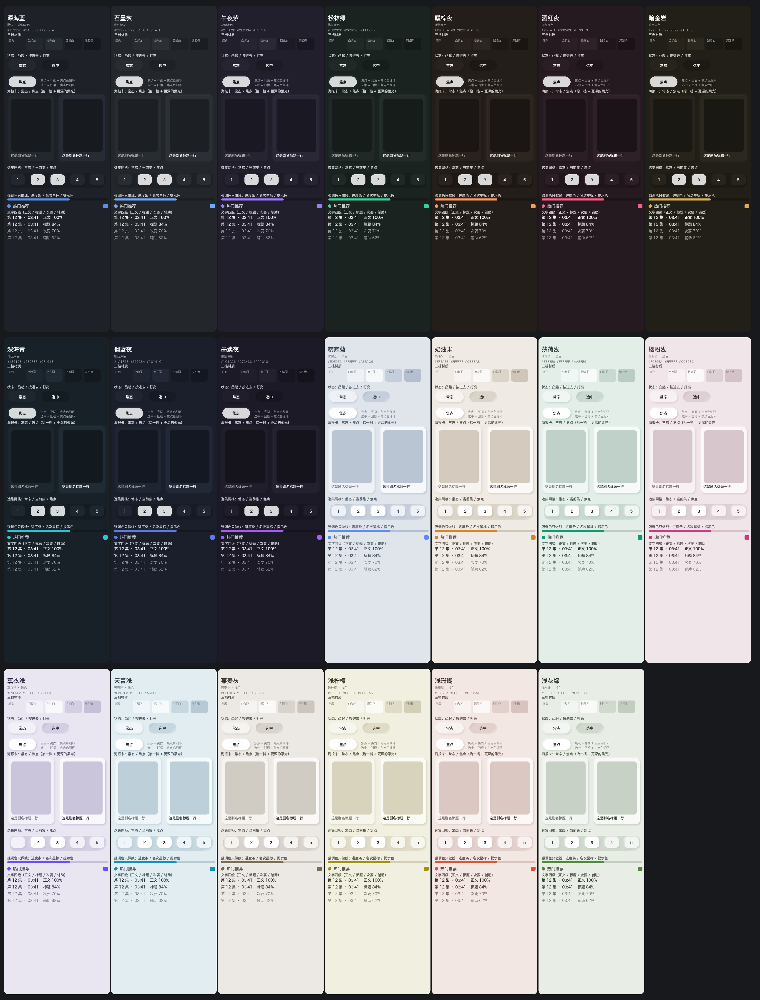

<p align="center"></p>

# 红果TV（Android TV 4.4+）

面向 Android TV 的短剧客户端：单 APK、Kotlin + ExoPlayer，装到电视上无需登录联网即用。

## 目录

- [功能](#功能)
- [界面](#界面)
- [下载](#下载)
- [当前限制](#当前限制)
- [工程结构](#工程结构)
- [开发](#开发)
- [维护者](#维护者)
- [参与贡献](#参与贡献)
- [许可证](#许可证)

## 功能

- **浏览**：首页分区剧架、热播榜（多榜单）、分类页（大类 / 小类），长列表右下角有「回到顶部」。
- **搜索**：关键词搜索，结果向下自动加载，滚到底部继续取；输入框按确认直达结果。
- **收藏与记录**：本机收藏、最近观看、稍后看，支持断点续播与「继续观看」直达。
- **手机号登录**：「我的」页用手机号 + 验证码登录，即可查看云端收藏、历史、点赞与预约，登录后可退出或刷新。
- **重装恢复**：卸载重装后自动恢复登录与设备身份，不用重新注册、重新收验证码。
- **选集**：详情页与播放器内同一套选集网格，按页翻看。
- **播放**：480P / 720P / 1080P 上限、0.75–2× 倍速、三种画面模式、自动连播。
- **视频解码**：硬件解码（默认，省电、4K 更稳）与软件解码（兼容性好，花屏 / 绿屏 / 音画不同步时用）可切换。
- **按键自定义**：播放界面的上下左右 / 菜单 / 确定键各做什么可改，支持一键恢复默认。
- **弹幕**：全屏 / 上方 / 隐藏三档，表情标签还原成表情图，字号与透明度可调。
- **定时停止**：按分钟或按集数到点暂停并保存进度。
- **播完推荐**：一集播完自动接下一集，全剧播完后推荐下一部。
- **手机辅助**：扫码在手机上输入搜索词、导出或导入本机记录（局域网，用完即关）。
- **应用内更新**：进入应用时若有新版本会弹窗询问；选「暂不更新」后不再主动提示，设置里也可手动检查；连不上 GitHub 时自动走镜像。
- **主题**：十四套材质主题，深浅都有。

## 界面

深色新拟态（Neumorphism）风格：全站只有一块材质，层次由「凸起 / 凹陷」与柔光表达；
播放界面不套新拟态，压在画面上的字与线固定暖白，避免和画面抢注意力。十四套材质主题如下：

交互原型（1280×720，含 20 套主题与各页面焦点态）：[`docs/prototype/index.html`](docs/prototype/index.html)。

<table>
<tr>
<td colspan="3" align="center"></td>
</tr>
<tr>
<td align="center"></td>
<td align="center"></td>
<td align="center"></td>
</tr>
<tr>
<td align="center"></td>
<td align="center"></td>
<td align="center"></td>
</tr>
<tr>
<td align="center"></td>
<td align="center"></td>
<td align="center"></td>
</tr>
</table>

## 下载

从 [Releases](https://github.com/pan8664716/HGTV/releases/latest) 下载最新正式 APK，拷到电视安装，或用 ADB 覆盖安装：

```sh
adb install -r HGTV_1.1.6.apk    # 文件名：<标识>_<版本号>.apk
```

进入应用时若发现新版本会弹窗询问，设置 → 版本与更新里也可手动检查并覆盖安装；本机收藏、进度与设置保留。
连不上 GitHub 时更新自动走镜像；手动下载也可用
[镜像地址](https://gh-proxy.org/https://github.com/pan8664716/HGTV/releases/latest)。
低于 1.1.2 的旧版无法在应用内升级，用上面的地址手动装一次即可，之后继续自动更新。

应用与红果官方无关联，内容接口为非官方实现，平台变化可能导致失效；
当前已知的限制见 [当前限制](#当前限制)。

### 依赖

- Android TV 或 Android 4.4（API 19）及以上的设备。
- APK 内置 ARM32 / ARM64 / x86 的崩溃采集库，其余为纯 JVM 代码；视频解码能力取决于设备，
  遇到花屏、绿屏或音画不同步可在设置里改用软件解码。
- 换用别的签名重建后不能覆盖安装本仓库发布密钥签名的 APK（卸载会清除本机记录）。

## 当前限制

平台是非官方接口，随版本变化随时可能失效。当前已知的限制：

### 播放

- 拉流地址是 CDN 直链，**有时效**；清晰度上限 1080P，个别编码的流会被跳过
  （部分设备只有声音没画面）。
- 偶发拿不到地址时界面会给出可重试的说明，稍后再试即可。

### 其他

| 现象 | 说明 |
| --- | --- |
| 搜索没结果 | 设备没在服务端注册过时搜索接口回空响应；下次启动会自动重新注册 |
| 弹幕条数少于平台自报 | 平台只下发采样热弹幕 |

平台接口随版本变化，个别功能可能短期不可用；界面上会给出可重试的说明。

## 工程结构

```
android/                Gradle 工程根（Android Studio 直接打开这一层）
├─ app/                 电视界面、遥控器焦点、本地收藏 / 进度、弹幕绘制层、ExoPlayer 播放器
├─ core/                内容列表、搜索、详情、播放地址解析、媒体分段与弹幕解析（纯 Kotlin，可在 JVM 测试）
│  └─ src/test/         单元测试与固定向量
├─ gradle/ gradlew       Gradle 8.14.3 包装器
└─ build.gradle.kts     构建脚本与发布签名配置
docs/                   项目文档；preview/ 放应用图标、主题图与界面截图
tools/                  图标 / 主题 / 界面校对脚本、静态校验脚本、构建与版本脚本
README.md NOTICE.md LICENSE
```

## 开发

需要 JDK 17、Android SDK Platform 36 / Build Tools 36.0.0；Gradle 8.14.3 包装器已随仓库提供。
设置 `ANDROID_HOME`，或在 `android/local.properties` 写入 `sdk.dir=<SDK 绝对路径>`。

```sh
# 开发包：直接可安装，无需发布私钥
./android/gradlew -p android :core:test :app:lintDebug :app:assembleDebug
adb install -r android/app/build/outputs/apk/debug/app-debug.apk
```

静态校验与离线校对图（校对图输出到 `docs/preview/.local/`，不入库）：

```sh
python3 tools/verify-button-system.py    # 按钮系统规则（全站唯一实现、三档尺寸、令牌化内边距）
python3 tools/app-icon.py --check        # 矢量 / 位图 / 背景色与脚本是否同源
python3 tools/app-icon.py                # 重出应用图标、电视横幅与 docs/preview/app-logo.png
python3 tools/theme-preview.py           # 十四套主题对比度自检 → docs/preview/theme.png
python3 tools/neumorphism-preview.py     # 首页 / 按钮六态 / 强调色校对（仅本机查看）
python3 tools/maintainer-avatars.py --check  # 维护者头像是否为 256px 圆形透明底
tools/version.sh                            # 应用名 / 标识 / 版本号 / 版本 code / 产物名
```

## 维护者
<table>
<tr>
<td align="center"><a href="https://github.com/pan8664716"><br><sub><b>pan8664716</b></sub></a></td>
</tr>
</table>

本项目是 [N3urda/hongguoTV](https://github.com/N3urda/hongguoTV) 的 fork，按 GPL-3.0-only 派生，上游代码著作权归其作者。**自 2026-10-06 起在上游基础上修改**：移除 React Native 电视版、iOS 工程与
Node / Docker 内容服务，只保留 Android TV 原生客户端并把 Gradle 工程收进 `android/`；包名由 `com.hongguotv.nativeapp` 改为 `com.hgtv.star`，应用名改为「红果TV」；重做界面与发布流程。逐项差异见 [变更记录](docs/CHANGELOG.md)，派生与第三方声明见 [NOTICE.md](NOTICE.md)。

## 参与贡献
提问或报 bug 请开 [Issue](https://github.com/pan8664716/HGTV/issues)；提交代码前请先开 Issue 说明意图。

### 贡献者
<table>
<tr>
<td align="center"><a href="https://github.com/pan8664716"><br><sub><b>pan8664716</b></sub></a></td>
<td align="center"><a href="https://github.com/N3urda"><br><sub><b>N3urda</b></sub></a></td>
<td align="center"><br><sub><b>ermilylu</b></sub></td>
</tr>
</table>

## 许可证

[GPL-3.0-only](LICENSE) © 2026 pan8664716；派生自 [N3urda/hongguoTV](https://github.com/N3urda/hongguoTV)（GPL-3.0，上游著作权归其作者）。派生说明与第三方依赖清单见 [NOTICE.md](NOTICE.md)。
