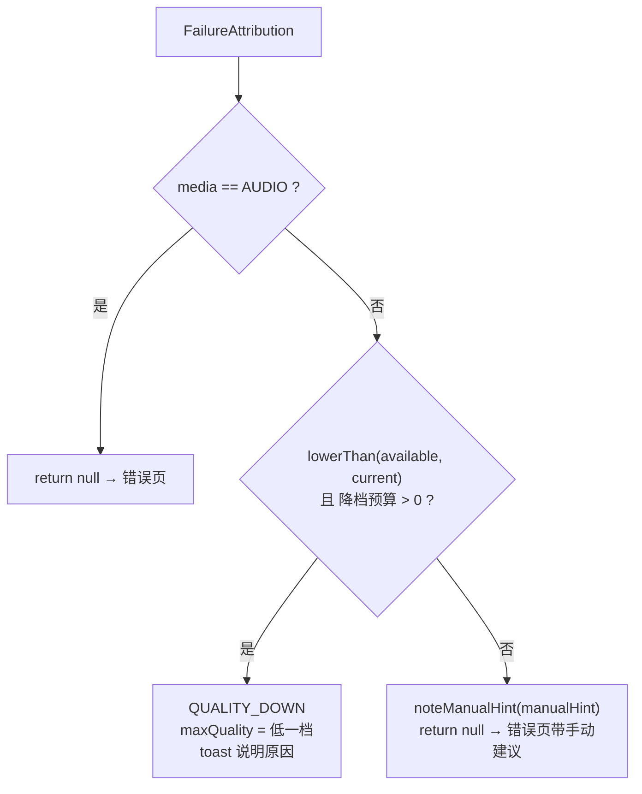
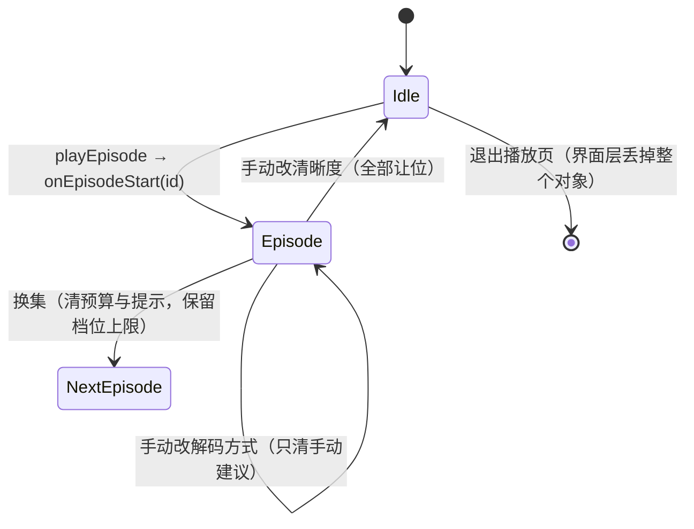
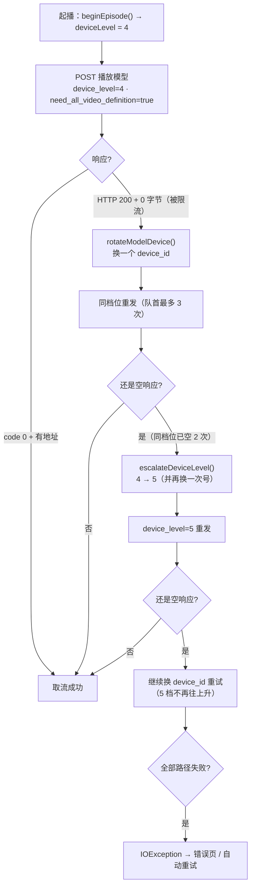
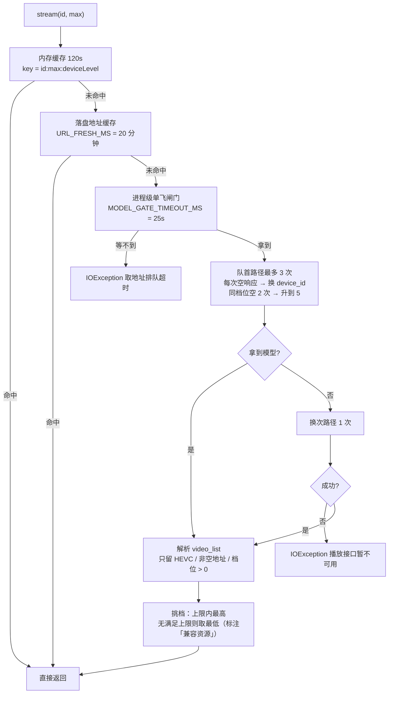
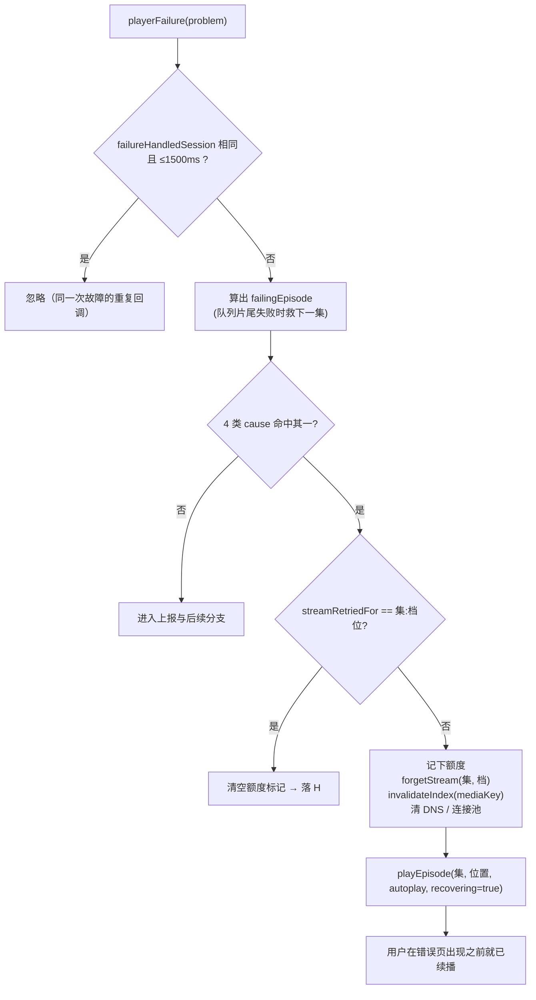
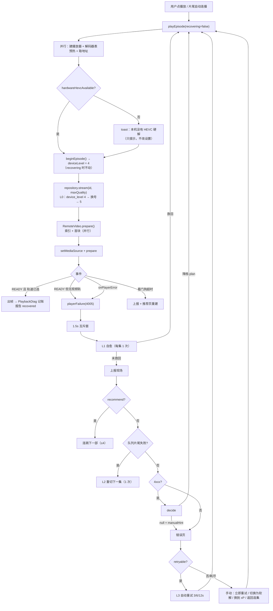

# 播放降级与重试策略（现状实现）

> 目标工程：`/Users/star/Documents/code/hongguoTV`（`com.hgtv.star`，ExoPlayer 2.19.1，Android 4.4+）
> 分析对象：正片播放页（`screen == "player"`）与推荐页（`screen == "recommend"`）共用的播放内核
> 关联文档：[推荐流与切换不卡-实现分析.md](./推荐流与切换不卡-实现分析.md)、[HONGGUO_API.md](./HONGGUO_API.md)
> 文档版本：v2.0（2026-10-29，HEVC-only 重构）

---

## 0. 摘要

一句话：**先自愈（缓存/网络层），再降档（每集两次、只降清晰度），最后才退避重试与错误页；切软解永远由用户自己点。**

| 问题 | 现状答案 |
| --- | --- |
| 视频编码有几种 | **只有 HEVC 一种**（接口标签 `bytevc1` / `h265_hvc1`）。`bytevc2` / AVC / VP9 / AV1 相关内容已全部删除，取地址时直接剔除 |
| 解码方式怎么选 | **优先硬解**。硬解筛空 → 4002 → 错误页提示「切换为软解 + 换到哪一档」，由用户手动点，**绝不自动切** |
| 降级能改哪几个维度 | 只剩一个：**降分辨率档**。换编码族、自动切软解这两维已整维删除 |
| 降档能降几次 | 视频每集 2 次（1080 → 720 → 480）；音频**不降档**，但有 1 次同档重建 |
| 会不会改用户设置 | 不会。降档只写会话层 `SessionPlaybackPolicy`；`Library.maxQuality` / `Library.decoderMode` 只由用户点选改写 |
| `device_level` 取值 | **只有 4 和 5**，默认 4。4 被限流 → 换 `device_id`；换号还被限流 → 升 5；5 再被限流 → 继续换 `device_id` |
| 为什么默认不带 5 | 5 档服务端算得更久。4 能命中的时候没必要多要两档 |
| 怎么「拿满 5 档」 | 请求参数 `need_all_video_definition=true` 是前提，`device_level` 只决定这套表里给几档 |
| 视频和音频用几条资源 | **永远同一条**。服务端只给一个 `main_url`（MP4 容器内含音轨），绝不出现「视频取 A、音频取 B」 |
| 可选清晰度 | 五档：**360 / 480 / 576 / 720 / 1080**（`PlaybackQuality.options`），与 `device_level=4/5` 下发的那套表一致 |
| 重试有几层 | 六层：取地址层（`device_id` 轮换 + 4→5 升档）→ 缓存自愈（每集 1 次）→ 队列下一集（1 次）→ 自动重试（3 次，3/6/12 秒）→ 手动重试 → 设备身份自愈（2 次 / 20 秒间隔） |
| 不抛异常的黑屏怎么办 | 三条判据：起播 15 秒无帧、起播 90 秒未就绪、停帧 12 秒无新帧，外加**播到一半缓冲 30 秒不前进**（每 3 秒巡检一次）。推荐页就地重建播放层（2 次 / 20 秒冷却） |
| 会不会无限循环 | 不会。降档预算每集重置，耗尽即返回 `null` 进错误页，绝不递归重试 |

---

## 1. 文件地图

| 关注点 | 文件 | 关键符号 |
| --- | --- | --- |
| **降级决策（全部纯逻辑）** | `android/core/src/main/kotlin/com/hgtv/star/core/PlaybackDegradation.kt` | `PlaybackDegradation.decide`(L247) `manualHint`(L230) `softwareQuality`(L215) `SessionPlaybackPolicy`(L84) `ToastDeduper`(L189) |
| **按集重试额度（账本）** | `android/core/src/main/kotlin/com/hgtv/star/core/PlaybackAttemptLedger.kt` | `onEpisodeStart` / `onEpisodeSwitch` / `onManualRetry` 三个重置入口；自动重试、画面重建、队列重开、地址自愈全在这里 |
| 降级规格（单测） | `android/core/src/test/kotlin/com/hgtv/star/core/PlaybackDegradationTest.kt` | 逐条对应上面的注释 |
| **失败入口与执行** | `android/app/src/main/kotlin/com/hgtv/star/MainActivityPlayback.kt` | `playerFailure`(L432) `replayWithPlan`(L406) `playbackAttribution`(L379) `playbackMediaKind`(L352) `scheduleRecovery`(L335) |
| 起播内核 | `android/app/src/main/kotlin/com/hgtv/star/MainActivityPlayer.kt` | `playEpisode`(L491) `applyDecoderMode`(L272) `decoderSelector`(L103) `playerDecoderMode`(L172) `playbackMaxQuality`(L140) `playbackDecoderMode`(L150) `preparedKeyFor`(L159) `probeHardwareHevcDecoder`(L484) |
| 看门狗与现场上报 | `android/app/src/main/kotlin/com/hgtv/star/PlaybackDiagnostics.kt` | `armPlaybackWatchdog`(L659) `armFrameStallWatchdog`(L809) `reportPlaybackFailure`(L478) `degradeInfo`(L529) |
| 自动重试预算 | `android/core/src/main/kotlin/com/hgtv/star/core/Watching.kt` | `RecoveryBudget`(L12) |
| **取地址与缓存** | `android/core/src/main/kotlin/com/hgtv/star/core/ContentRepository.kt` | `deviceLevel`(L806) `beginEpisode`(L815) `escalateDeviceLevel`(L818) `videoModel`(L2665) `modelBody`(L2738) `fetchModel`(L2762) `tryModelPath`(L2808) `stream`(L3019) `fetchStream`(L3103) `isHevcCodec`(L3373) `forgetStream`(L3073) `rotateDeviceForRetry`(L3101) |
| 视频字节读取 | `android/core/src/main/kotlin/com/hgtv/star/core/RemoteVideo.kt` | `range` `prepare` `warm` `read` |
| 落盘缓存 | `android/core/src/main/kotlin/com/hgtv/star/core/PlaybackCache.kt` | `URL_VERSION=3` `URL_FRESH_MS` `invalidateUrl` `invalidateIndex` |
| 解码能力探测 | `android/app/src/main/kotlin/com/hgtv/star/data/PlaybackCapability.kt` | `canDecodeHevc`(L61) `hasHardwareHevcDecoder`(L74) `defaultQuality`(L50) |
| 推荐页专线 | `android/app/src/main/kotlin/com/hgtv/star/MainActivityRecommend.kt` | `recoverRecommendPicture` `skipRecommend` `RECOMMEND_SKIP_LIMIT`(L31) `preparedKey` |
| 设备身份自愈 | `android/app/src/main/kotlin/com/hgtv/star/MainActivityAccount.kt` | `healDeviceIdentity`(L543) `applyPlaybackCapability`(L341) |

---

## 2. 三条铁律

### 2.1 铁律一：视频编码只有 HEVC

平台下发的可播视频只有 HEVC。因此：

| 位置 | 做法 |
| --- | --- |
| 取地址（`fetchStream`） | 只留 `isHevcCodec` 为真的档位：`bytevc1` / `h265_hvc1` / `hevc` / `h265` / `hvc1` / `hev1` 收；`bytevc2` / `bvc2` / `h264` / `avc` / `avc1` / `h263` / `vp9` / `av01` / `mp4v-es` 剔；**空标签照收**（老片源没有 `codec_type`，实测容器就是 hvc1，剔掉等于老剧全不能播） |
| 数据结构 | `StreamInfo` 不再有 `actualCodec` 字段；`FailureAttribution` 也没有 codec |
| 降级决策 | 没有 `CODEC_FAMILY_DOWN`，`DegradationKind` 只剩 `QUALITY_DOWN` |
| 落盘缓存 | `PlaybackCache` 的 `URL_VERSION` 已升到 3（旧格式带编码字段，读到即作废） |
| 能力探测 | 只探 `video/hevc`：`hasHardwareHevcDecoder` / `canDecodeHevc` |
| 调试面板 | 只列 HEVC 一行，不再列一堆用不上的解码器 |

### 2.2 铁律二：硬解优先，软解必须用户自己点

- `decoderSelector(mode)`：视频按用户的硬解/软解设置过滤；**筛空就返回空表**，不再 `ifEmpty { all }` 静默降软解。
- 音频不受这个开关影响，一律走全表（软解 AAC 的开销可忽略，没必要为它牺牲兼容性）。
- `playerDecoderMode()` **就等于** `library.decoderMode`，本机有没有硬解不会自动改它。
- 起播前探测到没有 HEVC 硬解：只弹一次提示「本机没有 HEVC 硬解，可在播放设置里切换为软件解码」（去重键 `集:hevc-hw`）。
- 硬解失败且降无可降：`decide()` 返回 `null`，把处置建议写进 `sessionPlayback.manualHint`，错误页照抄这句话，并给出可点的按钮（见 4.5）。

### 2.3 铁律三：视频和音频永远同一条资源

服务端每一个清晰度档只给一个 `main_url`，音轨在同一个 MP4 容器里（`video_list[x].main_url`，没有独立的音频地址）。因此：

| 约束 | 实现 |
| --- | --- |
| 一次取流只有一条地址 | `fetchStream` 从同一个 `video_list` 里挑一档，返回**唯一**的 `StreamInfo(url=…)` |
| 不拼接不同响应的轨道 | 全工程没有 `audio_url` / 第二条媒体地址的概念；`MediaSource` 永远是单条 `ProgressiveMediaSource` |
| 换档 = 换整条流 | 降档走 `forgetStream` + 重新取地址 + `playEpisode`，视频与音频一起换，不会出现「视频 720、音频 1080」 |
| 索引/首块缓存不串档 | `StreamInfo.mediaKey(id) = "$id:$actualQuality"`（实际档位为 0 时用请求上限）——按**实际档位**做键，换档就是换键 |

> 这一条同时解释了为什么「音频解码失败」不该降档：音频没有独立的降级目标，它跟着视频那条流走。因此音频的自动处置只有一条——**把解码器放掉重开一次**（每集 1 次）；重建也起不来，说明本机所有音频解码器都不可用，换哪一档都一样。

### 2.4 清晰度档位：五档，360 到 1080

`PlaybackQuality.options = [360, 480, 576, 720, 1080]`，设置里的「默认清晰度」与播放菜单里的「清晰度」行都按这张表出选项。

| 项 | 规则 |
| --- | --- |
| 取值范围 | 只有这五档。`normalize` 把表外的值（含老数据里的 540 / 896 / 1440）一律按 **1080** 处理 |
| 与接口的关系 | `device_level=4/5` + `need_all_video_definition=true` 下发的正是这套表（全是 HEVC），选哪档就按哪档取流 |
| 默认值怎么给 | 只在用户还没自己选过时（`Library.qualityChosenByUser`）按 HEVC 硬解能力给：≥1080 → 1080；≥720 → 720；≥576 → 576；≥480 → 480；更低或**没有硬解** → 480 |
| 降档怎么走 | 降档只在 `available` 里往下取一档（见 4.4），因此从 1080 开始最多降到 480；上限本身是 360 时就没有可降的档，直接进手动处置 |

> 为什么要补 360 与 576：少写一档就等于「用户选不到，老数据里存着的那一档还会被 `normalize` 顶到 1080」——弱机上正好是最需要低档的地方。

---

## 3. 失败归因层

### 3.1 第一步：这次失败落在哪条轨

`playbackMediaKind()`（L352）顺着 cause 链（深度上限 8）找 `ExoPlaybackException` 的 `rendererFormat.sampleMimeType` / `rendererName`，再退到 `DecoderInitializationException.mimeType`。

认不出轨道时**默认按 `VIDEO`**（保守：视频路径有预算、有归因，误判成音频会直接进错误页）。
判成 `AUDIO` 的意义：音频失败与「视频解码能力不足」**无关**，不能动档位、不能清 HEVC 探测结果。这正是早期「音频 4001 → 清晰度被压到 480」那个 bug 的正解。

### 3.2 第二步：阶段归类（`playbackStage`）

| 错误码区间 | stage | 含义 | 是否进降级 |
| --- | --- | --- | --- |
| `1xxx` | `playback_source` | 源不可用 / 资源没了 | ❌ |
| `2xxx` | `playback_io` | 读视频出错（网络层） | ❌（走自愈/重试） |
| `3xxx` | `playback_parse` | 容器/封装解析失败 | ❌ |
| `4001` | `playback_decoder_init` | 解码器初始化失败 | ✅ |
| `4002` | `playback_decoder_query` | 找不到可用解码器 | ✅ |
| `4003` | `playback_decoding` | 解码过程中出错 | ✅ |
| `4004` | `playback_decoder_limits` | 格式超出设备解码能力 | ✅ |
| `4005` | `playback_decoder_unsupported` | 设备不支持该编码 | ✅ |
| `4xxx` 其它 | `playback_decoding` | 厂商自定义码 | ✅ |
| 无 `PlaybackException` | `playback_prepare` / `playback_io` / `playback_oom` / `playback_other` | 本地准备 / 网络 / 内存 | ❌ |

### 3.3 第三步：结构化归因 `FailureAttribution`

```kotlin
data class FailureAttribution(
    val media: MediaKind,              // VIDEO / AUDIO
    val errorCode: Int,                // ExoPlayer 4xxx
    val currentQuality: Int,           // 真正在播那一档（不是用户设置）
    val currentMode: VideoDecoderMode, // 实际生效的硬解/软解
    val available: List<Int>           // 本次响应里所有可播档位（已只剩 HEVC）
)
```

四个关键取值口径（`playbackAttribution`，L379）：

| 字段 | 取值 | 为什么 |
| --- | --- | --- |
| `currentQuality` | `video?.info?.actualQuality > 0` 否则 `playbackMaxQuality` | 用户设 1080、CDN 只给 480 时，失败的其实是 480 那条，降档只能从 480 往下找 |
| `currentMode` | `playerDecoderMode()`（= 用户设置） | 用户可能自己点过「软件解码」，那时降档判据与错误页文案都与硬解不同 |
| `available` | `info?.available`，空则退化成「只有当前这一档」 | 没有结构化档位时「降无可降」，直接进错误页——比瞎猜一个 480 安全 |
| `errorCode` | `PlaybackException.errorCode` | 非 ExoPlayer 路径没有数字码，走 `playbackFailureTag` 的稳定常量 |

`available` 在 `fetchStream` 里已经筛过一遍：只留 HEVC、`main_url` 非空、`qualityOf` 认出档位（>0）的项。**它既是「能降到哪」的依据，也是「建议用户换到哪一档」的依据。**

### 3.4 第四步：四种可自愈异常的识别

`playerFailure` 在降级之前先做四类 cause 探测（都限深度 8，防环形 cause）：

| 探测函数 | 命中类型 | 现场含义 |
| --- | --- | --- |
| `streamExpiredOf` | `StreamExpiredException` | 地址被服务端提前作废（403/404） |
| `videoChangedOf` | `VideoChangedException` | 这一集文件换过，`Content-Range` 总长与索引不符 |
| `hasCauseOf<UnknownHostException>` | DNS 解析不出来 | 域名从 CDN 下线 / 解析被污染 |
| `transportDeadOf` | `SocketTimeout` / `Connect` / `NoRouteToHost` / `SSLException` | 解析成功但路走不通（NAT 表项被回收、半死连接） |

网络类判断必须**优先于**类型判断：同一个 `UnknownHostException` 可能被 `PlaybackPrepareException`、`HttpDataSourceException` 或 `PlaybackException` 包一两层，只看最外层永远归错类（现场那次「本地准备失败」的真因就是视频 CDN 域名解析不出来）。

---

## 4. 降级体系：只剩「降清晰度」

### 4.1 预算

| 维度 | `DegradationKind` | 预算（每集） | 执行的改动 |
| --- | --- | --- | --- |
| 降分辨率档 | `QUALITY_DOWN` | **2** | `maxQuality = lowerThan(available, current)` |
| 音频 | `SAME_QUALITY_REBUILD` | **1** | 只把解码器放掉重开，不降档、不改解码方式 |
| 换编码族 | 已删除 | — | 全站只有 HEVC，没有第二条编码可换 |
| 自动切软解 | 已删除 | — | 改为错误页上的手动按钮 |

`budgetSummary()` 输出形如 `降档 1/2`，调试面板直接显示这一行。

### 4.2 决策流程图（`decide`）



顺序即优先级：**先看有没有更低档，能降就降；降无可降才把决定权交回用户。**

### 4.3 决策矩阵

前提：上限 1080、`available` 含 1080/720/480（全是 HEVC）：

| 错误码 | 当前档 | 第一次 | 第二次 | 第三次 |
| --- | --- | --- | --- | --- |
| 任意 4xxx（硬解） | 1080 | 降 720（`硬解不支持 1080P，已降为 720P`） | 降 480 | `manualHint` + 错误页 |
| 任意 4xxx（硬解） | 720（只有 720/480） | 降 480 | `manualHint` + 错误页 | — |
| 任意 4xxx（硬解） | 480（已是最低） | `manualHint` + 错误页 | — | — |
| 任意 4xxx（软解） | 1080 | 降 720（`已降为 720P（原 1080P 无法解码）`） | 降 480 | `manualHint` + 错误页 |
| 音频 4001 / 4003 | 任意 | 同档重建（静默） | 错误页（`音频解码失败，这台设备无法播放该音轨。`） | — |
| 音频 4002 / 4004 / 4005 | 任意 | 错误页（同上） | — | — |

### 4.4 两个判据的实现要点

| 判据 | 实现 | 为什么这么写 |
| --- | --- | --- |
| `lowerThan(available, current)` | 过滤 `quality > 0 && quality < current`，取最大 | 只降一档，不跳档（跳过中间档会少一次自愈机会） |
| `softwareQuality(available)` | `available` 里 `≤720` 取最高；没有 `≤720` 的取最低 | 只用于**建议档位**：720 在弱 CPU 上普遍能跑，1080 软解在盒子上必掉帧；不做运行时掉帧探测（误报率高） |

### 4.5 手动处置建议与错误页按钮

`manualHint(attr)` 只产出两句话，都必须点明**具体档位**：

| 当前解码方式 | 文案 |
| --- | --- |
| 硬解 | `本机硬解不支持 {当前}P（HEVC），请在播放设置里切换为软件解码，并选择 {建议}P 及以下 的清晰度。` |
| 软解 | `软件解码也放不了 {当前}P（HEVC），请在播放设置里选择 {建议}P 及以下 的清晰度。` |

错误页（`playerFailure`，L432）上的按钮：

| 按钮 | 出现条件 | 动作 |
| --- | --- | --- |
| 立即重试 | 总是 | `rotateDeviceForRetry()` + `sessionPlayback.onManualRetry()` + `playEpisode(集, retryPosition, retryAutoplay)` |
| 切换为软解 | `playbackDecoderMode == HARDWARE && playbackHevcSupported` | 写 `library.decoderMode = SOFTWARE` + `onManualDecoderChange()` + `setMaxQuality(softTarget)` + `applyDecoderMode()`（同时降档：只换解码器不降档，1080 软解照样卡） |
| 换到 {softTarget}P | `softTarget > 0 && softTarget != actualQuality` | `rotateDeviceForRetry()` + `setMaxQuality(softTarget)` + `playEpisode(recovering=true)` |
| 返回选集 | 总是 | `returnToDetail(true)` |

文案优先级（`playbackText`）：

1. 音频输出失败（5xxx）→ `音频输出初始化失败，可重试或稍后再试。`
2. 音频解码失败 → `音频解码失败，这台设备无法播放该音轨。`
3. 有 `manualHint` → 照抄
4. 解码类失败且 `!playbackHevcSupported` → `这台电视没有 HEVC 硬解，请在播放设置里切换为软件解码。`
5. 其它解码类 → `电视无法解码当前视频，可在播放设置里换更低清晰度或软件解码。`
6. 其它 → `播放失败，可重试或切换清晰度。`

> **不再自动切软解的理由**：HEVC 软解在电视盒子上多数会掉帧甚至卡死，替用户做这个决定等于把「画面卡顿」换掉「明确报错」；而用户点过一次之后，`library.decoderMode` 会一直保持，下一集直接按软解起播。

### 4.6 会话状态的生命周期



| 字段 | 跨集是否沿用 | 理由 |
| --- | --- | --- |
| `effectiveMaxQuality` | **沿用** | 「这一档这台机器放不了」是设备结论；下一集回到用户设置只会再撞一次同样的失败 |
| `manualHint` | 换集清空 | 建议是针对当时那一集那一档给的 |
| `used`（预算） | **每集清零** | 预算按集计 |
| `lastReason` | 换集清空 | 调试面板只显示「这几集发生过什么」 |

四个手动入口的语义差异：

- `onManualRetry()`（错误页「立即重试」）：只清预算，**不撤销已降档位** —— 倒退只会再撞一次同样的失败。
- `onManualQualityChange()`（用户点清晰度）：撤销自动降档 + 清预算，之后完全按他设的上限走。
- `onManualDecoderChange()`（用户点解码方式）：只清 `manualHint`，**不动** `effectiveMaxQuality` —— 他只是换了解码器，不代表要把档位退回去。
- `onUserManualChange()`：全部让位（退出播放页时用）。

### 4.7 执行：`replayWithPlan`（L406）

只有一条回放路径，参数不同而已：

| 步骤 | 动作 | 为什么 |
| --- | --- | --- |
| 1 | 取断点 `player.currentPosition`（失败时 `playbackReady` 可能已清，`currentPosition()` 会退回本集开头） | 否则「降级一次就从头播」 |
| 2 | 弹一次 toast（`ToastDeduper` 按 `集:理由` 去重） | 连播时同一事实不重复弹 |
| 3 | 撤两条看门狗、`cancelRecovery`、`cancelPrefetch`、`dropQueuedEpisode`、`restoreBufferingUi`、`retirePreviousEpisode` | 它们都是按**上一次起播**排的，留着会抢解码器或往旧目标推进 |
| 4 | `maxQuality` 写会话层 → `forgetStream(id, 新档位)` → `playEpisode(episodeIndex, at, play, recovering=true)` | 不清缓存会命中刚才那条流，直接再失败一次、白烧一份预算 |
| 5 | `recovering=true` | 不重置 `RecoveryBudget`、不清 `streamRetriedFor` |

> 键的一致性：`repository.forgetStream` / `PlaybackCache.invalidateIndex` / 预取槽 `preparedKeyFor` 的键都只含**集 + 档位**（编码那一段已随 HEVC-only 删除）。

### 4.8 提示去重（`ToastDeduper`）

| 场景 | 键 | 上限 |
| --- | --- | --- |
| 降级提示 | `${episodeId}:${reason}` | `capacity = 64`（LRU 淘汰最早一条） |
| CDN 缺档 | `${episodeId}:select:${actualQuality}` | 同上 |
| 起播前「没有 HEVC 硬解」 | `${targetId}:hevc-hw` | 同上 |

---

## 5. `device_level`：只有 4 和 5

### 5.1 取值与语义

| `device_level` | `need_all_video_definition` | 结果 |
| --- | --- | --- |
| **4（默认）** | `true` | 通常给 4 档左右，五档全是 HEVC |
| **5** | `true` | 拿满 5 档，同样全是 HEVC |

- 官方值 `1/2/3` 一律不用：那一档下发的 360/480/576/720 是 `bytevc2`（Android 没有解码器），被 `fetchStream` 过滤后只剩 1080P，「默认 480P」形同虚设，还会表现成「一集 480P、一集 1080P」来回跳。
- `deviceLevel` 的 setter 把任意输入夹到 4/5：`value >= 5 → 5`，否则 `4`。
- `need_all_video_definition=true` 是**拿满 5 档的前提**，每个请求都带；不带它服务端只回 1 档。

### 5.2 限流处置流程



关键点：

1. **先换号，再升档**。空响应是「这台设备（`device_id`）被挡」，换号立刻恢复（实测换号后 0 间隔 10/10；同一个号 3 秒间隔只有 5/6）。升档是第二步，不是第一步。
2. **升到 5 之后本集不回退**；下一集 `beginEpisode()` 重置回 4。限流是临时状态，上一集被限流不代表下一集也要多要两档。
3. **换号要连缓存一起作废**：`modelCache` 的键是 `"$id@$deviceLevel@g$modelCacheGen"`，`rotateModelDevice` 会让 `modelCacheGen++`，否则 60 秒内会命中「旧身份换来的地址」。
4. **取流缓存键也带档位**：`cacheKeyOf(id, maxQuality) = "$id:$maxQuality:$deviceLevel"`。4 与 5 是两套清晰度表，换档后拿回的是另一份地址，缓存互相命中就是「换档没生效」。
5. **`forgetStream` 读的是当前档位**：降档/重试要按新档位删缓存，否则删的是另一条，真正那条还留在盘上。

### 5.3 与解码能力无关

`device_level` 只决定「服务端给几档、给哪套表」，与「这台机器能不能硬解 HEVC」没有任何关系。因此：

- `applyPlaybackCapability()` 只设置 `hardwareHevcAvailable` / `playbackHevcSupported` / 默认清晰度，**不写** `repository.deviceLevel`；
- 解码失败时重探能力（`PlaybackCapability.invalidate` + 重探）也**不碰** `deviceLevel`；
- 调试面板「降级」行单独显示 `档位 4/5`，与 `mode=HARDWARE/SOFTWARE` 是两件事。

---

## 6. 重试体系（六层）

### 6.0 六层总表

| 层 | 触发 | 额度 | 间隔 | 落点 | 代码 |
| --- | --- | --- | --- | --- | --- |
| **L0 取地址** | 每次 `stream()` | 队首路径 3 次（`MODEL_BLANK_RETRIES+1`），次路径 1 次 | ≥200ms（`MODEL_SPACING_MS`），进程级串行闸门 | 每次空响应换 `device_id`；同档位空 2 次升到 5 档 | `ContentRepository.fetchModel` / `tryModelPath` |
| **L1 缓存自愈** | 4 类 cause 命中 | **每集每档 1 次** | 立即 | 丢地址 + 丢索引 + 清 DNS + 清空闲连接 → 就地重起播 | `playerFailure` 自愈段 |
| **L2 队列下一集** | 片尾自动推进没接上 | **每集 1 次**（`autoNextFailures<1`） | 立即 | 从下一集开头重切 | `playerFailure` 队列分支 |
| **L3 自动重试** | 错误页上 `retryable` | **3 次** | 3s / 6s / 12s | 换 `device_id` → 原位置续播 | `RecoveryBudget` + `retryRunnable` |
| **L4 手动重试** | 用户点按钮 | 不限 | 立即 | 换 `device_id` + 清本集预算 | 错误页按钮 |
| **L5 设备身份** | `101000` / `DeviceNotRegistered` | 2 次 / 进程 | ≥20s | 重注册 → 重试原请求 | `healDeviceIdentity` |

### 6.1 L0：取地址层

播放模型接口对**并发**与**按设备计的额度**极敏感（实测：20 并发 0 命中、单发 50~80% 命中；同一个 `device_id` 打多了就一律回 `200 + 0 字节`）。



三个要点：

1. **单飞 + 合并**：起播、下一集预取、推荐预热会同时要同一集地址，三份并发正好把唯一能用的那条压死。现在整个取地址段串行化，后来的等前一个，回来后直接吃缓存。
2. **换号有效、等待无效**：同一个号等 3 秒也只有 5/6，换号后 0 间隔 10/10。所以 `forgetStream` → `rotateDeviceForRetry`，`retryRunnable` 也换号。
3. **空响应 ≠ 业务错误**：空响应说明请求被网关挡了，可换号重试；`code≠0` 说明已经到了后端，重发是同一个结果，直接换下一条路径。

### 6.2 L1：缓存自愈（每集一次，用户看不见）



一次清三处，缺一不可：

| 清什么 | 为什么 |
| --- | --- |
| `HgtvDns.invalidate(host)`（视频域名） | 相邻几集常落在同一个 CDN shard，重取回来的地址多半还是同一个 host → 又命中那份坏 IP |
| `PlaybackTransport.evictIdleConnections()` | 进程级连接池记住了那条半死连接（NAT 表项被回收：写得出、读不回） |
| `RemoteVideo.close()`（由 `retirePreviousEpisode` 触发） | 在途那条连接要取消，才算「下一条一定重新建」 |

**为什么排在 `reportPlaybackFailure` 之前**：这是自愈路径，救回来就不该记一条故障。

### 6.3 L2：队列下一集失败（片尾接不上）

判据：`queuedEpisodeId != null` 且播放位置 ≥ `duration - 2000ms`。只给一次重切：地址失效 / 鉴权失败 / 无法解码时反复重切，用户看到的是画面一黑一亮地循环。

### 6.4 L3：自动重试（退避）

只在**错误页**上启动，触发条件是 `retryable`：

```kotlin
retryable = if(problem is PlaybackException) {
    problem.errorCode in 2000..2999 || problem.errorCode == ERROR_CODE_TIMEOUT
} else {
    problem is java.io.IOException
}
```

即：只有「读视频出错（2xxx）/ 超时 / 非 ExoPlayer 包装的 IOException」才自动重试。
**3xxx（封装解析）与 4xxx（解码）不自动重试**：前者重试同一条流结果不变，后者是降级该管的事——降级返回 `null` 才落到错误页。

| 轮次 | 延迟 | 界面文案 |
| --- | --- | --- |
| 1 | 3s | `准备恢复播放 · 3.0 秒后重试 1/3 · 00:12` |
| 2 | 6s | `… 2/3 …` |
| 3 | 12s | `… 3/3 …` |
| 耗尽 | — | `已自动重试 3 次，仍无法播放。可手动重试或切换清晰度。` |

三个细节：

- **间隔 3/6/12 秒**：原间隔在 8.5 秒里连发几十个取地址请求，而这接口空响应是网关按并发挡的，重试越密越起不来。
- **断网不消耗额度**：`retryRunnable` 发现没网就重新 `scheduleRecovery()`，额度留着；网络恢复时 `NetworkWatcher` 的回调会再排一次。
- **每次重试都换 `device_id`**：同一个号连试三次大概率三次同一个结果。

### 6.5 L4：手动重试与「换到 xP」

见 4.5 的按钮表。要点：手动重试**清预算但不撤销已降档位**；「换到 xP」只在 CDN 真的给了 ≤720 的档且与当前档不同时才出现。

### 6.6 L5：设备身份自愈

判据只看接口明确语义，不看中文文案措辞：

- 搜索：`DeviceNotRegisteredException`（`200 + 0 字节`，平台对注册过的设备从不回空响应，强信号）；
- 播放：消息里含 `101000`（服务异常＝没注册过）。**播放的空响应不算**——那条路径本来就有一半概率偶发，拿它当判据会把好设备的身份反复换掉。

额度：2 次 / 进程，间隔 ≥20 秒；成功后换 `deviceIdentity` + 注册 Cookie，用本次请求的起点重播。

### 6.7 推荐页专线（规则完全不同）

推荐页没有选集、也没有详情页可回，因此它不走「错误页 + 重试」，而是**放不了就换下一部**。

| 机制 | 额度 | 动作 |
| --- | --- | --- |
| 播放失败换剧 | `recommendPlaybackFailures > RECOMMEND_SKIP_LIMIT(4)` 才停 | 否则 `playRecommendAt(next, 0, 1)`；到末尾先补页，补页失败则环绕回第 1 部 |
| 详情取不到 / 无分集 | `skipped >= 4` 停 | `skipRecommend` 跳到下一部 |
| 画面丢失重建 | `PICTURE_RECOVERY_LIMIT = 2`，冷却 `20s` | `showRecommendCover()` + `playEpisode(同集, 当前位置, recovering=true)`，不跳剧、不写历史、不改 `screen` |

**推荐页不消耗正片的降级预算**：`playerFailure` 里推荐页那条分支在降级决策**之前**就 `return` 了。

### 6.8 预取重试（严格限流）

| 条件 | 值 | 原因 |
| --- | --- | --- |
| 只在片尾窗口 | `(duration - position) / speed ≤ 30s` | `PrefetchPolicy.nearEnd`，长剧不能超出槽位 TTL |
| 起播后冷却 | `readySince ≥ 3000ms` | 起播那一下别抢带宽 |
| 缓冲余量 | `buffered - position ≥ 5000ms` | 同上 |
| 最大次数 | `prefetchAttempts >= 5` 放弃 | — |
| 重发间隔 | ≥ **10 秒** | 空响应是网关按并发挡的，贴太近只会一直占着并发额度 |
| 附加条件 | 非计费网络、有网、`!playbackFetching` | 起播正在取地址时预取必须让路 |

### 6.9 无异常兜底：两条看门狗

「READY 了、进度条在走、声音有、画面全黑」这条路**不抛异常**，进不了 `playerFailure`。

| 看门狗 | 判据 | 阈值 | 动作 |
| --- | --- | --- | --- |
| 起播看门狗 | 未 READY（卡缓冲） | `90s`（15s 粒度巡检） | 上报 `playback_stall_buffer` + 推荐页重建 |
| 起播看门狗 | 已 READY 但未出帧 | `15s`（起算自 READY 那一刻） | 上报 `playback_stall_frame` + 推荐页重建 |
| 停帧看门狗 | 已在播、最近一帧超时 | `12s`，每 `4s` 巡检 | 上报 `playback_stall_frame` + 推荐页重建 |

`pictureUpNow()` 同时看「首帧回调」**和**「逐帧心跳」，因为隧道模式与部分老系统不回调 `onRenderedFirstFrame`。停帧看门狗在 `lastFrameAt == 0` 时**直接让路**：那说明这条渲染路径根本不走逐帧回调。

---

## 7. 端到端主流程图



---

## 8. 常量总表（排障时对着这张表看）

| 常量 | 值 | 位置 | 含义 |
| --- | --- | --- | --- |
| 降档预算 | 2 | `PlaybackDegradation.QUALITY_DOWN_LIMIT` | 每集每视频轨 |
| 音频重建预算 | 1 | `PlaybackDegradation.AUDIO_REBUILD_LIMIT` | 只重建，不降档 |
| `device_level` | 4 / 5 | `ContentRepository.deviceLevel` | 默认 4，限流升级 5 |
| 升档阈值 | 同档位空 2 次 | `tryModelPath` | 换号之后仍被挡 |
| 失败互斥窗 | 1500ms | `playerFailure` | 同会话同一次故障只处理一条 |
| `codec_error` 延迟 | 1500ms | `playbackDiagnostics` | 与互斥窗同长，避免同一次失败两条记录 |
| 自愈额度 | 每集每档 1 次 | `streamRetriedFor` | 4 类可自愈失败共用 |
| 片尾判据 | 2000ms | `playerFailure` / 队列分支 | 距末尾 2 秒内算「片尾」 |
| 自动重试 | 3 次 / 3s·6s·12s | `RecoveryBudget` | 只对 2xxx/超时/IOException |
| 起播无帧 | 15s（tick 15s） | `WATCHDOG_NO_FRAME_MS` | 自 READY 起算 |
| 起播卡缓冲 | 90s | `WATCHDOG_STALL_MS` | 未进 READY |
| 停帧 | 12s（tick 4s） | `FRAME_STALL_MS` | 需确实在播 |
| 推荐页重建 | 2 次 / 冷却 20s | `PICTURE_RECOVERY_*` | 只推荐页 |
| 推荐页连跳 | >4 部停 | `RECOMMEND_SKIP_LIMIT` | — |
| 设备自愈 | 2 次 / 间隔 20s | `DEVICE_HEAL_*` | 进程级 |
| 取地址闸门 | 25s | `MODEL_GATE_TIMEOUT_MS` | 单飞等待上限 |
| 取地址间隔 | 200ms | `MODEL_SPACING_MS` | 只挡异常连打 |
| 队首空响应重试 | 3 次 | `MODEL_BLANK_RETRIES+1` | 每次换 `device_id` |
| 模型缓存 | 60s | `MODEL_CACHE_MS` | 键带 `deviceLevel` 与 `modelCacheGen` |
| 地址内存缓存 | 120s | `STREAM_CACHE_MS` | 键带档位与 `deviceLevel` |
| 地址落盘缓存 | 20 分钟 | `URL_FRESH_MS` | 过期或被 403 就重取；`URL_VERSION=3` |
| 索引落盘 TTL | 7 天 | `INDEX_TTL_MS` | 文件变了靠 `total` 校验先挡 |
| 缓存目录上限 | 48MB | `PlaybackCache.MAX_BYTES` | 超了按 `lastModified` 淘汰最旧一半 |
| 预取窗口 | ≤30s 到片尾 | `PrefetchPolicy.nearEnd` | 按倍速折算墙钟 |
| 预取次数/间隔 | 5 次 / 10s | `maybePrefetch` | — |

---

## 9. 互斥、去重与观测

### 9.1 互斥与去重

| 机制 | 作用 | 位置 |
| --- | --- | --- |
| 1.5s 互斥窗（带会话号） | `onPlayerError` 与 `STATE_ENDED` 可能对同一次片尾故障各来一次，只处理第一条；新一集自己的错误不会被误吞 | `playerFailure` 开头 |
| `pendingCodecReport` 取消 | 解码器报错延后 1.5 秒的那条，若已带完整 cause 链报过，这条作废 | `playerFailure` 开头 |
| `ToastDeduper(64)` | 同一 `集:理由` / `集:缺档` / `集:hevc-hw` 一次播放只弹一次 | `MainActivityPlayback` |
| `PlaybackDiag.claim` | 去重键 **阶段+错误码**，一次启动最多 12 条；`playback_codec_error` 单独 3 条额度 | `PlaybackDiagnostics` |
| `takeRecovered()` | 报过失败、之后真的出画面 → 记一条正样本（`recovered mode=...`），不发异常 | `onRenderedFirstFrame` |
| 降级现场 `degrade=` | 上报里带 `cap/req/actual/level/mode/plan/hint/budget/avail` | `reportPlaybackFailure` |
| 调试面板「降级」行 | `降清晰度 · 降档 1/2 · 档位 4` / 降无可降时 `待手动处理 · 降档 2/2 · 档位 5` | `DebugOverlay` |

### 9.2 观测口径

`budgetSummary()` 的价值：用户报「一直弹降级提示」时，这一行能直接分清是**预算没生效**（次数超过上限）还是**真的连降了两次**（次数就是 2，说明片源那几档都解不了）。

| 关键字 | 含义 |
| --- | --- |
| `model device_level 4 -> 5` | 本集被限流，升到 5 档 |
| `model device fresh <id>` | 换了一个新的 `device_id` |
| `model path=<path> attempt=<n> level=<4/5> bytes=0` | 这条路空响应（被限流） |
| `Degrade reason=QUALITY_DOWN quality=<n>` | 一次降档被执行 |
| `Playback failure stage=<stage> tag=<tag> code=<code> degrade=...` | 一次失败现场（已去重） |
| `recovered mode=<hw/sw> res=<档> dev=<厂商 型号>` | 降级/重试之后真的出画面了 |

### 9.3 用户可见结果对照表

| 故障 | 用户看到什么 | 是否打断播放 |
| --- | --- | --- |
| CDN 缺请求档（1080 → 720） | 起播成功，弹一次「CDN 没有 1080P，已用 720P」 | 不打断 |
| 本机没有 HEVC 硬解 | 起播提示「本机没有 HEVC 硬解，可在播放设置里切换为软件解码」，**不自动改设置** | 不打断 |
| 取地址被限流 | 用户无感（后台换号，必要时升到 5 档） | 不打断 |
| 地址过期 / 文件换过 / DNS 坏 / 连接死 | 短暂停顿后从原位置继续（**不给错误页**） | 短暂停顿 |
| 解码失败但还能降档 | 弹一次「硬解不支持 1080P，已降为 720P」，从原位置继续 | 短暂黑屏 |
| 解码失败且降无可降 | 错误页 + 建议原文 + 「切换为软解」「换到 720P」按钮 | 打断 |
| 用户点「切换为软解」 | 重建播放器，按软解 + 建议档位续播，之后一直保持软解 | 短暂黑屏 |
| 网络断（2xxx / 超时） | 错误页 + 「准备恢复播放 · 3 秒后重试 1/3」，联网后自动续播 | 打断但自恢复 |
| 解析失败（3xxx） | 错误页，只有手动按钮（不自动重试） | 打断 |
| 推荐页某一部放不了 | 直接换下一部（最多连跳 4 部） | 不打断（换内容） |
| 推荐页黑屏有声 | 盖黑场 → 就地重建播放层 → 淡出（同一部同一位置） | 短暂黑场 |
| 设备身份被拒（101000） | 无感重注册后用同一位置重播 | 短暂停顿 |

---

## 10. 已知边界与取舍

| 取舍 | 现状 | 理由 |
| --- | --- | --- |
| 只有 HEVC，没有备用编码 | 取流时剔除其它编码 | 平台只下发 HEVC；`bytevc2` 在 Android 上没有解码器，AVC 只存在于更早的片源，留着只会让同一部剧一集一个编码 |
| 不自动切软解 | 任意档都交给用户点 | HEVC 软解在盒子上多数会掉帧甚至卡死；替用户静默切换会让「画面卡顿」取代「明确报错」 |
| `device_level` 只用 4/5 | 1/2/3 一律不用 | 低档位的 360/480/576/720 是 `bytevc2`，过滤后只剩 1080P |
| 默认 4，不默认 5 | 只有被限流才升 | 5 档服务端算得更久；4 能命中的时候没必要多要两档 |
| 升到 5 不回退（本集） | 下一集才重置回 4 | 避免「每集都先被 4 档限流一次」 |
| 音频只重建不降档 | 每集 1 次同档重建 | 音频没有独立资源可换，但 4001 / 4003 仍可能是瞬态的（解码器实例被占 / 解到坏帧），重建一次往往就好 |
| 不预检掉帧 | 只按分辨率给软解建议 | 运行时掉帧探测误报率高，而且这一步是用户手动触发的最后手段 |
| 解码器 fallback 仍开着 | `setEnableDecoderFallback(true)`，但**视频选择器筛空就返回空表** | 不静默降软解：筛空 → 4002 → 走可见的手动处置 |
| 起播前只提示一次 | 按 `集:hevc-hw` 去重 | 同一台机器的事实不必每集都说一遍 |

---

## 11. 验证清单

| 验证点 | 方法 |
| --- | --- |
| 决策表本身 | `android/core/src/test/kotlin/com/hgtv/star/core/PlaybackDegradationTest.kt`（纯 JVM，不需要设备） |
| 取地址与挑档 | `android/core/src/test/kotlin/com/hgtv/star/core/ContentRepositoryTest.kt`：非 HEVC 档位永不被选中、`device_level` 默认 4 且被夹在 4/5、`need_all_video_definition=true` 在请求体里 |
| 跑单测 | `cd android && JAVA_HOME=<jdk17> ./gradlew :core:test` |
| 真实降级链路 | 调试包 `DebugFaults` 注入：`DECODER_NONE`（→4002/4005）、`DECODER_BOGUS`（→4001）、`PREPARE_FAIL`（→本地准备失败）、`STALL_FRAME`（→有声音无画面） |
| 预算是否生效 | logcat 找 `Degrade reason=QUALITY_DOWN`；调试面板「降级」行看 `x/2` |
| 限流升档 | logcat 找 `model path=... bytes=0 level=4` → `model device fresh` → `model device_level 4 -> 5` |
| 是否救回来 | logcat 找 `recovered mode=hw/sw res=...` |
| 自愈是否触发 | `Stream expired; refetching url` / `Video changed; ...` / `Video host unresolved; ...` / `Transport dead; ...` |
| 自动重试节奏 | `Automatic playback recovery 1/3 at ...ms`，间隔应约 3s / 6s / 12s |
| 看门狗 | `Playback failure stage=playback_stall_frame` 或 `playback_stall_buffer` |

---

## 12. 一句话总结

**降级只剩「降清晰度」这一件事，视频两次预算；音频不降档、只给一次同档重建；解码方式与档位由用户在错误页上手动处置；`device_level` 是「4 默认、限流换号、还不行升 5、5 再限流继续换号」；每一集永远只有一条流，视频和音频共用它。**
错误码是分界线：`4xxx` 归降级（设备能力问题），其余归重试（地址 / 网络 / 封装问题）；而「地址过期 / 文件换过 / DNS 坏 / 连接死」这四类介于两者之间的失败，被单独提到最前面做**自愈**，因为它们的修法是「丢缓存重来」，既不该烧降级预算，也不该让用户看见错误页。
