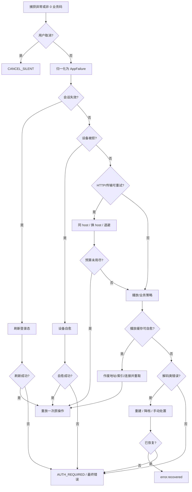

# 错误码统一处理规范

> 适用范围：Android、iOS、共享 Kotlin 核心、网络层、播放器、账号、存储、更新和本地服务
> 文档状态：目标规范 v1.0
> 更新时间：2026-11-22
> 关联文档：[播放降级与重试策略.md](docs/播放降级与重试策略.md)、[HONGGUO_API.md](docs/HONGGUO_API.md)、[PHONE_LOGIN.md](docs/PHONE_LOGIN.md)

---

## 0. 结论

业务代码不应为每个接口单独写一套错误处理。所有错误先统一转换成一份稳定的 `AppFailure`，再由唯一的 `ErrorPolicy` 决定：

1. 是否重试；
2. 是否换域名；
3. 是否刷新登录态；
4. 是否重新注册设备；
5. 是否作废地址、索引、首块或模型缓存；
6. 是否降清晰度、重建解码器或停止播放；
7. 用户看到什么；
8. 日志和统计记录什么。

错误码只描述“发生了什么”，不能直接决定 UI，也不能在各个业务层被各自解释。

---

## 1. 目标与非目标

### 1.1 目标

- HTTP 状态码、上游业务码、设备身份、会话、播放器、媒体、存储、更新和系统错误使用同一套模型。
- 同一个错误在所有入口得到同一个处置结论。
- 重试有且只有一个所有者，禁止多层嵌套重试。
- 用户提示、诊断日志和统计使用稳定错误码，不依赖中文文案。
- 新接口、新平台、新播放器只增加“映射”，不复制“决策”。
- Android 和 iOS 对同一业务错误使用同一 canonical code 和同一处置结果。

### 1.2 非目标

- 不要求把上游所有业务码都改写成项目自己的数字。
- 不要求隐藏上游码；上游码要保留在诊断字段里。
- 不要求所有错误都重试。大多数 4xx、参数错误、权限错误和内容结构错误重试没有意义。
- 不允许为了“自动恢复”而无限换设备、无限换域名或无限重播。

---

## 2. 核心原则

| 原则 | 规定 |
| --- | --- |
| 单一错误模型 | 业务层只接收 `AppFailure`，不再接收裸 `Exception.message` 做判断 |
| 错误码稳定 | canonical code 一旦发布不得复用、改名或改变语义 |
| 上游码保留 | `upstreamCode` 与 `canonicalCode` 分开记录 |
| 先分类后决策 | 先归一化，再交给策略；禁止在 UI 里判断 HTTP 数字或播放器数字 |
| 重试单所有者 | 传输层、业务服务、播放器策略、UI 手动重试各管一层，不叠加 |
| 有界恢复 | 每次恢复必须有次数、时间、资源范围和冷却时间 |
| 取消不重试 | 用户切页、换剧、退出造成的取消必须静默结束 |
| 幂等优先 | 只有只读请求或明确幂等的写请求允许自动重试 |
| 用户提示与诊断分离 | 用户看到短文案；日志保留 operation、host、status、upstreamCode、attempt、cause |
| 安全日志 | 不记录 Cookie、token、签名头、完整响应体、手机号、验证码、设备私密字段 |

---

## 3. 统一错误模型

### 3.1 `AppFailure`

建议使用如下 Kotlin 形态，iOS 对应生成同字段模型：

```kotlin
enum class FailureDomain {
    TRANSPORT, HTTP, API, AUTH, DEVICE,
    CONTENT, PLAYBACK, MEDIA, STORAGE,
    UPDATE, PERMISSION, IMAGE, DANMAKU, LAN, UNKNOWN
}

enum class FailureDisposition {
    CANCEL_SILENT,
    RETRY_SAME_HOST,
    RETRY_OTHER_HOST,
    REFRESH_AUTH,
    RE_REGISTER_DEVICE,
    INVALIDATE_CACHE,
    FALLBACK_ENDPOINT,
    DEGRADE_QUALITY,
    RESTART_DECODER,
    WAIT_USER,
    SHOW_FINAL_ERROR,
    DROP_AND_SKIP
}

enum class FailureSeverity {
    INFO, WARN, ERROR, FATAL
}

data class AppFailure(
    val domain: FailureDomain,
    val canonicalCode: String,
    val operation: String,
    val stage: String = "",
    val severity: FailureSeverity = FailureSeverity.ERROR,
    val disposition: FailureDisposition = FailureDisposition.SHOW_FINAL_ERROR,
    val retryable: Boolean = false,
    val retryAfterMs: Long? = null,
    val httpStatus: Int? = null,
    val upstreamCode: String? = null,
    val upstreamMessage: String? = null,
    val host: String? = null,
    val resourceId: String? = null,
    val attempt: Int = 0,
    val maxAttempts: Int = 0,
    val userMessageKey: String? = null,
    val debugDetail: String? = null,
    val cause: Throwable? = null
)
```

### 3.2 字段语义

| 字段 | 规定 |
| --- | --- |
| `domain` | 错误属于哪一层，不表示哪个页面 |
| `canonicalCode` | 项目 canonical code，例如 `HTTP_503`、`API_101000`、`PLAYER_4001` |
| `severity` | 只用于日志和产品优先级，不参与重试决策 |
| `operation` | `home`、`detail`、`search`、`stream`、`range`、`play`、`login`、`update` 等 |
| `stage` | `dns`、`connect`、`response`、`parse`、`prepare`、`decode`、`install` 等 |
| `disposition` | 策略建议动作，不是 UI 动作 |
| `retryAfterMs` | 来自 `Retry-After` 或本地退避计算 |
| `httpStatus` | 原始 HTTP 状态，不能丢 |
| `upstreamCode` | 服务端 `code`、`Code`、`error_code`、`error_name` 原值 |
| `upstreamMessage` | 服务端可诊断信息，必须限长并脱敏 |
| `host` | 当前请求域名或 CDN host |
| `resourceId` | 剧集、分集、账号操作、更新包等资源标识 |
| `attempt/maxAttempts` | 当前尝试和总预算 |
| `userMessageKey` | 文案资源键，不是中文文案本身 |
| `debugDetail` | 只在调试面板、日志和问题反馈中使用 |

### 3.3 错误归一化优先级

同一个失败只能产生一个 canonical code。按以下顺序归一化：

1. 用户取消、线程中断、主动 cancel：`CANCEL_*`；
2. 已知本地语义异常：`DEVICE_*`、`MEDIA_*`、`STORE_*`、`UPDATE_*`；
3. HTTP 状态：`HTTP_*`；
4. HTTP 2xx 内的业务码：`API_*`；
5. 响应结构、字段缺失、解析失败：`CONTENT_*`；
6. 播放器错误码：`PLAYER_*`；
7. 未知异常：`UNKNOWN`。

例外：

- 播放模型接口同时有 `Code` 和 `code` 时，优先 `Code`。
- HTTP 200 + 空响应体不直接归为 `CONTENT_EMPTY`，必须按 endpoint 语义分类。
- 同一个异常链里如果同时存在 DNS、TLS、HTTP 包装和播放器包装，优先保留最靠近根因的那一层。

### 3.4 严重级别

新增 `severity` 仅用于日志和产品优先级，不参与重试决策：

| 级别 | 场景 |
| --- | --- |
| `INFO` | 可恢复的取消、自动重试成功 |
| `WARN` | 瞬时网络、限流、单次解析失败 |
| `ERROR` | 用户可见失败、业务码拒绝、设备失效 |
| `FATAL` | 无法继续、需要退出或用户手动处理 |

---

## 4. 错误域总表

| 域 | 典型来源 | 是否自动重试 | 典型处置 |
| --- | --- | --- | --- |
| `TRANSPORT` | DNS、TCP、TLS、超时、断网 | 有条件 | 换域、清 DNS、退避、等待网络 |
| `HTTP` | 4xx、5xx、429、403、404 | 有条件 | 同 host 重试、换 host、刷新登录、作废缓存 |
| `API` | 平台 JSON `code` / `Code` / `error_code` | 按码 | 设备注册、参数修正、业务提示 |
| `AUTH` | 登录过期、需要登录、MFA | 有条件 | 刷新会话、重新登录、继续轮询 |
| `DEVICE` | 设备未注册、身份被拒、注册失败 | 有条件 | 重注册、换身份、停止自动恢复 |
| `CONTENT` | 空内容、字段变化、内容不存在 | 多数不重试 | 空态、降级、换接口、提示 |
| `PLAYBACK` | Exo 1xxx 至 5xxx | 按码 | 自愈、降档、重建解码器、错误页 |
| `MEDIA` | Range、索引、解密、文件变化 | 有条件 | 换 CDN、作废索引、重取地址 |
| `STORAGE` | 文件损坏、空间不足、权限、快照版本 | 多数不重试 | 回退、清理、提示用户 |
| `UPDATE` | 元数据、下载、校验、安装 | 有条件 | 重下、重试、提示安装结果 |
| `PERMISSION` | 存储、安装、通知、网络权限 | 不自动重试 | 引导用户授权 |
| `IMAGE` | 图片下载、解码、缓存 | 可有限重试 | 占位图、降尺寸、跳过 |
| `DANMAKU` | 弹幕接口、解析、渲染 | 不阻塞播放 | 局部空态、关闭弹幕、继续播放 |
| `LAN` | 局域网发现、连接、同步 | 有条件 | 重扫、提示设备不可达 |
| `UNKNOWN` | 未识别异常 | 默认不重试 | 记录现场、最终错误页 |

---

## 5. Canonical Code 目录

### 5.1 传输与网络

| Code | 触发 | 默认处置 | 用户提示 |
| --- | --- | --- | --- |
| `CANCEL_USER` | 用户切页、换剧、退出 | `CANCEL_SILENT` | 无 |
| `CANCEL_TIMEOUT` | 业务主动取消导致超时 | `CANCEL_SILENT` | 无 |
| `NET_OFFLINE` | 当前无可用网络 | `WAIT_USER` | 当前网络不可用 |
| `NET_DNS` | `UnknownHostException` | `RETRY_OTHER_HOST`，清 DNS | 网络异常 |
| `NET_CONNECT` | `ConnectException`、`NoRouteToHostException` | `RETRY_OTHER_HOST` | 网络连接失败 |
| `NET_TIMEOUT` | connect/read/call timeout | 同 host 一次，再换 host | 网络超时 |
| `NET_TLS` | `SSLException`、证书/握手失败 | 换 host，不盲目重试 | 安全连接失败 |
| `NET_IO` | 其他 IO、连接中断 | 有条件重试 | 网络异常 |

### 5.2 HTTP 状态

| Code | 触发 | 默认处置 | 备注 |
| --- | --- | --- | --- |
| `HTTP_400` | 参数或请求体错误 | `SHOW_FINAL_ERROR` | 不换 host，不重试 |
| `HTTP_401` | 未认证或登录失效 | `REFRESH_AUTH` | 刷新后最多重放一次 |
| `HTTP_403` | 权限、风控或签名地址失效 | 按 operation 分类 | API 与播放 CDN 不同 |
| `HTTP_404` | 资源或路径不存在 | `FALLBACK_ENDPOINT` 或 `INVALIDATE_CACHE` | 播放地址 404 可作废地址 |
| `HTTP_405` | 方法不允许 | `SHOW_FINAL_ERROR` | 修请求方法 |
| `HTTP_408` | 请求超时 | `RETRY_SAME_HOST` | 有预算再换 host |
| `HTTP_409` | 资源冲突 | `SHOW_FINAL_ERROR` | 写操作需用户确认 |
| `HTTP_410` | 资源永久不存在 | `SHOW_FINAL_ERROR` | 不再重试 |
| `HTTP_412` | 条件请求失败 | `FALLBACK_ENDPOINT` | 重新取完整资源 |
| `HTTP_413` | 请求体过大 | `SHOW_FINAL_ERROR` | 不重试 |
| `HTTP_415` | 媒体类型不支持 | `SHOW_FINAL_ERROR` | 不重试 |
| `HTTP_416` | Range 不可满足 | `INVALIDATE_CACHE` | 重新取地址/索引 |
| `HTTP_422` | 语义校验失败 | `SHOW_FINAL_ERROR` | 不重试 |
| `HTTP_425` | 请求过早 | 短延迟重试 | 有预算时 |
| `HTTP_429` | 限流 | 按 `Retry-After` 退避 | 不立即重试 |
| `HTTP_499` | 客户端主动关闭 | `CANCEL_SILENT` | 不记录为业务失败 |
| `HTTP_500` | 服务内部错误 | `RETRY_OTHER_HOST` | 有预算时 |
| `HTTP_502` | 网关错误 | 同 host 一次，再换 host | 官方同类错误会重试 |
| `HTTP_503` | 服务不可用 | 按 `Retry-After` 退避 | 有预算时 |
| `HTTP_504` | 网关超时 | 同 host 一次，再换 host | 有预算时 |
| `HTTP_OTHER_4XX` | 未列出的 4xx | `SHOW_FINAL_ERROR` | 默认不重试 |
| `HTTP_OTHER_5XX` | 未列出的 5xx | 有预算时重试 | 有预算时 |

### 5.3 业务 API

| Code | 触发 | 默认处置 | 备注 |
| --- | --- | --- | --- |
| `API_EMPTY` | 2xx + 0 字节 | 按 endpoint 分类 | 不能全局当作成功或失败 |
| `API_SCHEMA` | JSON 结构变化、字段缺失 | `SHOW_FINAL_ERROR` | 记录 endpoint 和缺失字段 |
| `API_100001` | 参数错误 | `SHOW_FINAL_ERROR` | 修请求参数，不重试 |
| `API_100103` | 请求形状或游标问题 | 按 operation 分类 | 搜索可重试；写操作先修 body |
| `API_101000` | 设备未注册或服务异常 | `RE_REGISTER_DEVICE` | 播放模型必须走设备自愈 |
| `API_110001` | 身份、query 或密文不一致 | `RE_REGISTER_DEVICE` | 不能只换 host |
| `API_10001010A` | 风控或环境风险 | `SHOW_FINAL_ERROR` | 记录 logid，不盲目重试 |
| `API_103008` | 缺少社区能力或 aid 参数 | `SHOW_FINAL_ERROR` | 配置/参数问题 |
| `API_UNKNOWN` | 未登记非零业务码 | `SHOW_FINAL_ERROR` | 默认不重试，进入观测队列 |

### 5.4 登录与会话

| Code | 触发 | 默认处置 | 备注 |
| --- | --- | --- | --- |
| `AUTH_SESSION_EXPIRED` | `data.error_name == "session_expired"` | `REFRESH_AUTH` | HTTP 可能仍是 200 |
| `AUTH_REQUIRED` | 操作必须登录 | `WAIT_USER` | 引导登录 |
| `AUTH_CODE_1` | 挑战/会话过期 | 重新发码 | 不无限轮询 |
| `AUTH_CODE_3` | 缺少参数 | 修 body | 不重试 |
| `AUTH_CODE_7` | 访问过频 | 等 `retry_time` | 不立即重试 |
| `AUTH_CODE_22` | 非法应用 | 修 aid/app | 不重试 |
| `AUTH_CODE_1045` | 短信尚未被平台识别 | 继续轮询，有上限 | 不是最终失败 |
| `AUTH_CODE_2046` | 需要二次验证 | 进入 MFA | 不是普通失败 |
| `AUTH_CODE_9001` | 验证挑战过期 | 停止轮询 | 重新发码 |

### 5.5 设备身份

| Code | 触发 | 默认处置 | 备注 |
| --- | --- | --- | --- |
| `DEVICE_UNREGISTERED` | 搜索空响应、播放 101000 | `RE_REGISTER_DEVICE` | 先确认 endpoint 语义 |
| `DEVICE_REGISTER_FAILED` | 注册接口失败 | 有预算时换 host | 注册本身是写操作，需防重复 |
| `DEVICE_HEAL_EXHAUSTED` | 自愈次数或间隔用尽 | `SHOW_FINAL_ERROR` | 不再循环换号 |
| `DEVICE_PROFILE_INVALID` | query 与密文不一致 | 重建身份并注册 | 对应 110001 一类 |

### 5.6 内容与数据

| Code | 触发 | 默认处置 | 备注 |
| --- | --- | --- | --- |
| `CONTENT_EMPTY` | 合法接口返回空列表 | 显示空态 | 不等于错误 |
| `CONTENT_NOT_FOUND` | 明确不存在 | 显示空态或返回 | 不重试 |
| `CONTENT_SCHEMA_CHANGED` | 解析器找不到必需字段 | 记录并提示 | 可尝试兼容路径 |
| `CONTENT_QUOTA` | 配额、设备额度、分页上限 | 停止翻页/提示 | 不盲目换设备 |
| `CONTENT_CURSOR_EXPIRED` | 搜索游标过期 | 回第 1 页 | 不重试旧游标 |
| `CONTENT_PARTIAL` | 多页/多源部分成功 | 展示已有数据 | 附加内容失败不拖垮主页面 |

### 5.7 播放器与媒体

| Code | 触发 | 默认处置 | 备注 |
| --- | --- | --- | --- |
| `PLAYER_SOURCE` | Exo 1xxx | 重取地址或换源 | 不直接降清晰度 |
| `PLAYER_IO` | Exo 2xxx | 网络重试或自愈 | 不能给换软解按钮 |
| `PLAYER_PARSE` | Exo 3xxx | 提示内容异常或换集 | 不能给换软解/换档位按钮 |
| `PLAYER_4001` | 解码器初始化失败 | 同档重建一次 | 再失败进入手动处置 |
| `PLAYER_4002` | 解码器查询失败 | 重探能力，给换软解建议 | 不盲目降档 |
| `PLAYER_4003` | 解码中失败 | 同档重建一次 | 坏帧/实例被占 |
| `PLAYER_4004` | 格式超出能力 | 降一档 | 每集最多两次 |
| `PLAYER_4005` | 格式不支持 | 降一档或换软解 | 每集最多两次 |
| `PLAYER_AUDIO_OUTPUT` | 5xxx | 重建音频/等待 | 不给视频换档按钮 |
| `PLAYER_UNKNOWN` | 未知播放器码 | 记录并显示最终错误 | 不做猜测式恢复 |
| `MEDIA_STREAM_EXPIRED` | 播放 Range 403/404 | 作废地址，换 CDN | 最多一次地址自愈 |
| `MEDIA_CHANGED` | `Content-Range` 总长变化 | 作废索引和首块 | 重新准备媒体 |
| `MEDIA_RANGE_BAD_STATUS` | 非 206、401、5xx 等 | 换 CDN 或重试 | 保留 HTTP 状态 |
| `MEDIA_INDEX_MISMATCH` | 样本越界、索引损坏 | 作废索引 | 不重试同一份索引 |
| `MEDIA_DECRYPT_FAILED` | 解密失败、密钥错误 | 作废首块和索引 | 不进入解码降级 |

### 5.8 存储、恢复、更新与系统

| Code | 触发 | 默认处置 | 备注 |
| --- | --- | --- | --- |
| `STORE_CORRUPT` | JSON、偏好、索引损坏 | 回退/重建 | 不覆盖用户有效数据 |
| `STORE_NO_SPACE` | 空间不足 | 提示用户清理 | 不自动删用户数据 |
| `STORE_IO` | 本地读写失败 | 有限重试/提示 | 不阻塞主流程 |
| `SNAPSHOT_NEWER_VERSION` | 快照来自更高版本 | 拒绝导入 | 不能降级覆盖 |
| `SNAPSHOT_CHECKSUM_FAILED` | 快照校验失败 | 拒绝导入 | 保留旧数据 |
| `UPDATE_METADATA_INVALID` | 版本、大小、SHA 不合法 | 最终错误 | 不下载 |
| `UPDATE_METADATA_EMPTY` | 更新元数据为空 | 有界重试 | 镜像或网关问题 |
| `UPDATE_DOWNLOAD_HTTP` | 更新包 HTTP 失败 | 按 HTTP 矩阵 | 下载必须校验 |
| `UPDATE_DOWNLOAD_SHORT` | 安装包长度不足 | 删除临时包并重下 | 不安装 |
| `UPDATE_CHECKSUM_FAILED` | 安装包校验失败 | 删除临时包并重下 | 不安装 |
| `UPDATE_INSTALL_ABORTED` | 用户取消安装 | 最终提示 | 不自动重复 |
| `UPDATE_INSTALL_BLOCKED` | 系统阻止安装 | 提示用户 | 不重复拉起 |
| `UPDATE_INSTALL_CONFLICT` | 包名/签名冲突 | 提示用户 | 不重试 |
| `UPDATE_INSTALL_INVALID` | 安装包损坏 | 删除并重新下载 | 不安装 |
| `UPDATE_INSTALL_INCOMPATIBLE` | 与设备不兼容 | 提示用户 | 不重试 |
| `UPDATE_INSTALL_STORAGE` | 安装空间不足 | 提示清理 | 不重试 |
| `PERMISSION_DENIED` | 存储、安装、通知等权限 | 引导授权 | 不自动重试 |
| `SYSTEM_UNAVAILABLE` | 系统服务缺失、NSD 失败 | 降级或提示 | 记录系统错误码 |
| `SYSTEM_OOM` | `OutOfMemoryError` | 释放资源、停止当前重任务 | 不自动重试 |
| `SYSTEM_SECURITY` | `SecurityException` | 引导授权或最终错误 | 不自动重试 |
| `SYSTEM_LINKAGE` | `NoSuchMethodError`、`VerifyError`、`LinkageError` | 最终错误并上报 | 属于兼容性缺陷 |
| `SYSTEM_ILLEGAL_STATE` | 生命周期或状态机非法 | 最终错误并上报 | 不自动重试 |
| `LOCAL_ARGUMENT` | 请求或本地参数非法 | 最终错误 | 修代码或输入 |
| `UNKNOWN` | 无法归一化 | 最终错误 | 记录 cause 链和 operation |

---

### 5.9 图片、弹幕与局域网

| Code | 触发 | 默认处置 | 备注 |
| --- | --- | --- | --- |
| `IMAGE_HTTP` | 图片 HTTP 失败 | 有界重试或占位图 | 不阻塞页面主流程 |
| `IMAGE_DECODE` | 图片解码失败 | 占位图 | 可降尺寸重试一次 |
| `IMAGE_TOO_LARGE` | 图片超过内存/尺寸上限 | 降采样或跳过 | 不无限重试 |
| `IMAGE_CACHE_IO` | 图片缓存读写失败 | 忽略并继续 | 不覆盖有效缓存 |
| `DANMAKU_HTTP` | 弹幕接口失败 | 局部空态 | 不阻塞视频播放 |
| `DANMAKU_PARSE` | 弹幕 JSON/字段异常 | 局部空态 | 记录 endpoint |
| `DANMAKU_RENDER` | 弹幕渲染资源失败 | 降级为无弹幕 | 不影响播放器 |
| `LAN_DISCOVERY` | NSD 发现失败 | 重新扫描或提示 | 记录系统错误码 |
| `LAN_CONNECT` | 局域网连接失败 | 有限重试 | 检查同网段 |
| `LAN_SYNC` | 局域网同步失败 | 提示并保留本机数据 | 不覆盖远端有效数据 |

---

## 6. HTTP 状态处理矩阵

### 6.1 成功与空响应

| 条件 | 处理 |
| --- | --- |
| `2xx` 且 JSON 成功 | 正常解析，业务码继续校验 |
| `206` 且 `Content-Range` 正确 | 视频 Range 成功 |
| `206` 但 Range 不匹配 | `MEDIA_RANGE_BAD_STATUS` 或 `MEDIA_CHANGED` |
| `204` | 视为成功，不要求 body |
| `304` | 使用缓存；不能走空响应故障逻辑 |
| `3xx` | 由 HTTP 客户端跟随重定向；最终状态决定处置；重定向循环直接失败 |
| `200 + 0 字节` | 按 endpoint 语义处理，见第 8 节 |
| `2xx` 但 JSON 损坏 | `API_SCHEMA` 或 `CONTENT_SCHEMA_CHANGED` |

### 6.2 4xx

| 状态 | 重试同 host | 换 host | 刷新登录 | 重注册设备 | 作废缓存 |
| --- | --- | --- | --- | --- | --- |
| 400 | 否 | 否 | 否 | 否 | 否 |
| 401 | 一次 | 否 | 是 | 否 | 否 |
| 403 API | 否 | 否 | 条件 | 条件 | 否 |
| 403 播放地址 | 否 | 是 | 否 | 否 | 是 |
| 404 API | 否 | 端点支持时 | 否 | 否 | 否 |
| 404 播放地址 | 否 | 是 | 否 | 否 | 是 |
| 408 | 是 | 有预算 | 否 | 否 | 否 |
| 409/410 | 否 | 否 | 否 | 否 | 否 |
| 412 | 否 | 端点支持时 | 否 | 否 | 条件 |
| 413/415/422 | 否 | 否 | 否 | 否 | 否 |
| 416 播放 Range | 否 | 否 | 否 | 否 | 是 |
| 425 | 短延迟一次 | 有预算 | 否 | 否 | 否 |
| 429 | 按 `Retry-After` | 有预算 | 否 | 否 | 否 |

### 6.3 5xx

| 状态 | 默认动作 |
| --- | --- |
| 500 | 有预算时换 host；无预算则最终错误 |
| 501/505 | 不重试，检查请求能力 |
| 502 | 同 host 一次，再换 host |
| 503 | 优先读 `Retry-After`，退避后重试；有预算时换 host |
| 504 | 同 host 一次，再换 host |
| 其他 5xx | 有预算时同 host 一次，再换 host |

`Retry-After` 必须支持两种格式：

- 秒数，例如 `120`；
- HTTP-date。

没有 `Retry-After` 时使用指数退避加随机抖动，不能固定毫秒风暴式重试。

### 6.4 网络异常

| 异常 | 处理 |
| --- | --- |
| DNS | 清 DNS 缓存，换 host；不立即重试同一解析结果 |
| Connect/NoRoute/TLS | 换 host，必要时清连接池 |
| Read/Write/Call timeout | 同 host 一次，再换 host；播放 Range 走自己的预算 |
| 用户取消 | 立即结束，不记录为故障 |
| 断网 | 等待网络恢复，不消耗自动重试额度 |

---

## 7. 业务码处理规则

### 7.1 成功判定

- 内容接口：`code == 0` 成功。
- 播放接口：先读 `Code`，取不到再读 `code`。
- 登录接口：`error_code == 0` 成功。
- 官网搜索：允许非 2xx 带业务 JSON 时先解析业务码，不能只按 HTTP 状态丢掉 body。

### 7.2 已知业务码

| 业务码 | 语义 | 统一动作 |
| --- | --- | --- |
| `100001` | 参数错误 | 最终失败，修参数，不重试 |
| `100103` | 请求形状/游标问题 | 搜索游标可重试；账号写操作不重试 |
| `101000` | 设备未注册/服务异常 | 设备自愈，成功后重放一次 |
| `110001` | 身份或密文不一致 | 作废模型缓存并重注册 |
| `10001010A` | 风控/环境风险 | 记录 logid，不盲目重试 |
| `103008` | 社区能力或 aid 缺失 | 修请求配置，不重试 |
| `session_expired` | 会话过期 | 刷新登录态，不当作网络错误 |
| `1045` | 二次验证短信未到 | 继续轮询，达到上限后失败 |
| `2046` | 需要二次验证 | 进入 MFA 流程 |
| `9001` | 验证挑战过期 | 停止轮询，重新发码 |

### 7.3 未知业务码

默认规则：

1. 不自动重试；
2. 记录 `operation`、`upstreamCode`、`upstreamMessage`、`logid`；
3. 显示稳定的“服务暂不可用”提示；
4. 只有在该 endpoint 的显式 allowlist 中才允许重试。

禁止用中文 message 包含某个词来判断业务语义。

---

## 8. 空响应按接口分类

`HTTP 200 + 0 字节` 是平台常见现象，但不同接口含义不同。

| Endpoint | 空响应含义 | 处理 |
| --- | --- | --- |
| 搜索 `search/tab/v` | 设备未注册或网关拦截 | 同 host 补发一次；仍空则设备自愈，再失败才最终错误 |
| 播放模型 `video_model` | 档位、设备或模型异常 | 4 档升 5 档，再设备自愈；不无限换 host |
| 详情 `video_detail` | POST 形态或网关拦截 | 先 POST 改 GET，再换 host；不直接把空响应当设备失效 |
| 分类/推荐 | 网关或线路抖动 | 有界换 host，再退避重试 |
| 账号读接口 | 网关空包 | `retryBlank`，默认 4 次退避；只有明确设备信号才自愈 |
| 账号写接口 | 网关空包 | 仅在幂等且可去重时重试；否则先查结果 |
| 发行方作品 | 风控、空页或网关 | 换 host；仍空则退回搜索 |
| 相关作品 | 线路抖动 | 轮换线路，失败后作为附加内容隐藏 |
| 弹幕 | 采样为空或接口抖动 | 不阻塞播放，局部空态 |
| 更新元数据 | 镜像空包或 502 | 有界重试，最终提示检查失败 |

空响应处理必须同时记录：

- endpoint；
- host；
- HTTP 状态；
- body 长度；
- 是否稳定态 `tt_stable`；
- 设备档位；
- 是否已经做过设备自愈。

---

## 9. 重试与恢复预算

### 9.1 重试作用域

| 作用域 | 所有者 | 允许动作 |
| --- | --- | --- |
| `TransportRetry` | 网络传输层 | DNS、连接、TLS、HTTP 5xx/429 |
| `ServiceRetry` | 业务服务 | 换 host、空响应、业务码、设备自愈 |
| `PlaybackRangeRetry` | 媒体读取层 | 同 URL Range、备用 CDN、索引作废 |
| `PlaybackPolicy` | 播放决策层 | 同档重建、降档、音频重建、队列恢复 |
| `ManualRetry` | 页面层 | 用户明确点击，重置有限预算 |

同一请求不得同时由 `TransportRetry` 和 `ServiceRetry` 无限叠加。上层只看到下层已经用尽后的 `AppFailure`。

### 9.2 默认预算

| 场景 | 预算 | 退避 | 说明 |
| --- | --- | --- | --- |
| 普通 API 5xx/408 | 最多 5 次 | 200ms 起，指数退避，抖动，最高 2s | 参考官方 TTNet 默认配置 |
| 429 | 最多 5 次 | 优先 `Retry-After` | 没有头时指数退避 |
| 分类/推荐 | 3 次首屏，8 次翻页 | 100/180/300/450/650/900/1200ms | 沿用现有节奏 |
| 官网搜索单页 | 3 次 | 200/400ms | 502 可重试 |
| 播放模型 | 3 个 host | 每个 host 独立 20s 预算 | 单飞，不并发轰炸 |
| 相关作品 | 最多 8 次线路轮换 | 按现有节奏 | 失败后栏目可为空 |
| Range 同 URL | 2 次 | 200/500ms | 只对瞬态 IO/5xx |
| Range 备用 CDN | 每个地址一次 | 无额外等待 | 地址 403/404 可换 CDN |
| 解码器重建 | 每集 1 次 | 立即 | 4001/4003 |
| 降清晰度 | 每集 2 次 | 立即 | 4004/4005 |
| 音频重建 | 每集 1 次 | 立即 | 不降档 |
| 自动播放重试 | 3 次 | 3/6/12s | 2xxx、超时、5xxx |
| 设备自愈 | 进程内 2 次 | 至少 20s | 成功后重放一次 |
| 登录刷新 | 每条请求链 1 次 | 立即 | 刷新失败转 `AUTH_REQUIRED` |

### 9.3 幂等性

自动重试只允许：

- GET；
- 只读 POST；
- 明确幂等的写请求；
- 带操作幂等键、服务端可去重的写请求。

收藏、历史、预约、进度等写操作重试前必须确认：

1. 是否已有服务端幂等键；
2. 是否可以先查询最终状态；
3. 是否允许重复提交；
4. 重试失败是否需要本地补偿队列。

### 9.4 禁止事项

- 断网时继续消耗自动重试次数；
- 用户切页后继续重试；
- 对 400、401 以外的明确 4xx 无脑重试；
- 在一个请求里嵌套另一套完整重试；
- 连续快速换设备；
- 连续快速重取地址；
- 用 `runCatching` 把错误吞成“没有数据”而不记录原因。

---

## 10. 决策顺序

统一决策顺序如下。顺序是规则，不允许各页面自行调换：

1. **取消**：静默结束；
2. **会话失效**：刷新登录态；
3. **设备被拒**：设备自愈；
4. **endpoint 专属空响应/兼容路径**：先走明确 fallback；
5. **HTTP 状态与传输错误**：按矩阵重试或换 host；
6. **播放缓存自愈**：地址过期、文件变化、DNS 坏、连接死；
7. **解码能力**：同档重建、降档、音频重建；
8. **内容结构/业务拒绝**：最终错误或空态；
9. **未知错误**：记录并最终错误。

播放上下文中的 403/404 必须先判断是“地址过期”还是“账号/风控拒绝”，不能只看状态码。

---

## 11. 分层职责

| 层 | 只负责 | 不负责 |
| --- | --- | --- |
| `ContentTransport` / `HttpClient` | 发请求、读 body、生成 `HttpFailure` | 判断业务码、决定 UI |
| `ContentService` | 业务码映射、endpoint 语义、设备自愈钩子 | 画错误页、操作 View |
| `ErrorPolicy` | 纯决策、预算、优先级 | 网络 IO、线程、Android API |
| `PlaybackFailurePolicy` | 播放错误归因和恢复计划 | 直接改 UI |
| 页面层 | 执行动作、展示文案 | 解析异常字符串 |
| `Diagnostics` | 事件、字段、去重、脱敏 | 改变业务结果 |
| iOS Adapter | 将平台错误映射为同一 canonical code | 另写一套重试规则 |

---

## 12. 用户提示规范

用户提示只由 `userMessageKey` 决定，不能直接展示上游 message。

| 场景 | 提示方向 |
| --- | --- |
| 无网络 | 当前网络不可用，请检查网络后重试 |
| 网络超时 | 网络超时，请稍后重试 |
| 5xx/网关 | 服务器繁忙，请稍后重试 |
| 429 | 请求太频繁，请稍后重试 |
| 登录过期 | 登录已过期，请重新登录 |
| 设备初始化 | 设备正在初始化，请稍后重试 |
| 内容不存在 | 内容暂不可用 |
| 内容结构异常 | 内容格式异常，请稍后重试 |
| 播放地址过期 | 正在重新获取播放地址 |
| 封装解析失败 | 当前视频内容异常，请重试或换集 |
| 解码器失败 | 按实际错误给“重试 / 换软解 / 换档位” |
| 音频输出失败 | 音频输出初始化失败，可重试或稍后再试 |
| 存储不足 | 存储空间不足，请清理后重试 |
| 更新校验失败 | 安装包校验失败，请重新下载 |

错误码只能出现在：

- 调试面板；
- 日志；
- 用户主动打开的问题反馈页；
- 诊断报告。

普通错误页不直接展示 `HTTP 502`、`101000`、`4001` 等原始码，除非产品明确要求“短码反馈”。

---

## 13. 可观测性

### 13.1 事件

建议统一四个事件：

| 事件 | 时机 |
| --- | --- |
| `error.raised` | 首次归一化出 `AppFailure` |
| `error.retry_scheduled` | 已安排重试/换 host/设备自愈 |
| `error.retry_finished` | 单次重试结束 |
| `error.recovered` | 后续请求或播放真正成功 |
| `error.final` | 所有自动恢复结束，交给用户 |

### 13.2 必带字段

- `domain`
- `canonicalCode`
- `operation`
- `stage`
- `attempt`
- `maxAttempts`
- `elapsedMs`
- `host`
- `httpStatus`
- `upstreamCode`
- `upstreamMessage`，限长
- `resourceId`
- `retryAfterMs`
- `disposition`
- `recovered`

### 13.3 去重

去重键：

```text
domain + canonicalCode + operation + resourceId + stage
```

同一会话、同一资源、同一阶段的重复回调只记一条最终错误，但重试次数和恢复结果单独计数。

---

## 14. 端到端状态机



---

## 15. 代码落点建议

建议新增或收敛到以下职责：

| 文件 | 职责 |
| --- | --- |
| `core/error/AppFailure.kt` | 错误模型、域、处置枚举 |
| `core/error/ErrorCatalog.kt` | canonical code 与上游码映射 |
| `core/error/ErrorPolicy.kt` | 纯决策入口 |
| `core/error/RetryBudget.kt` | 次数、时间、退避、冷却 |
| `core/network/HttpFailureMapper.kt` | HTTP 状态、网络异常到 `AppFailure` |
| `core/content/*/ErrorMapper.kt` | endpoint 业务码与空响应语义 |
| `shared/media/PlaybackFailureMapper.kt` | Exo 码、媒体码、播放上下文 |
| `feature-*/.../ErrorPresenter.kt` | `userMessageKey` 到页面文案 |
| `shared/debug/ErrorDiagnostics.kt` | 事件、去重、脱敏 |

`ContentTransport` 只负责传输，不应继续新增业务码分支。业务服务只负责映射，不直接决定重试次数。页面只负责执行 `disposition`。

---

## 16. 测试矩阵

每个错误码至少要有以下测试之一：

| 测试 | 预期 |
| --- | --- |
| 2xx + `code=0` | 成功 |
| 200 + 空 body，搜索 | 补发一次，再设备自愈 |
| 200 + 空 body，播放模型 | 4 档升 5 档，再设备自愈 |
| 200 + 空 body，详情 | POST 改 GET，再换 host |
| 400 | 不重试，最终错误 |
| 401 | 刷新会话一次，再重放 |
| 403 API | 不盲目重试 |
| 403 播放地址 | 作废地址，尝试备用 CDN |
| 404 播放地址 | 作废地址，尝试备用 CDN |
| 408 | 有界重试 |
| 429 + `Retry-After` | 按指定时间等待 |
| 500/502/503/504 | 有界重试和换 host |
| 用户取消 | 不重试、不报错 |
| `100001` | 最终错误 |
| `100103` 搜索 | 有界重试 |
| `100103` 账号写 | 不重试，修请求 |
| `101000` | 设备自愈一次 |
| `110001` | 重注册设备，不盲换 host |
| `10001010A` | 最终错误，记录 logid |
| `session_expired` | 刷新登录，不按网络错误处理 |
| `4001` | 同档重建一次 |
| `4003` | 同档重建一次 |
| `4004` | 降一档 |
| `4005` | 降一档 |
| `2xxx` | 网络重试，不给换软解/换档位 |
| `3xxx` | 内容异常，不给换软解/换档位 |
| 音频 5xxx | 音频重建，不给视频换档 |
| Range 403/404 | 作废地址，尝试备用 CDN |
| `Content-Range` 变化 | 作废索引和首块 |
| 快照版本更高 | 拒绝导入，不覆盖 |
| 更新 SHA 不符 | 删除临时包，不安装 |
| 网络断/恢复 | 断网不耗额度，恢复后重试 |

建议把“错误码 -> 处置”表做成纯 JVM 测试，不依赖 Android。页面层只测试按钮是否按 `disposition` 和 `FailureCapability` 显示。

---

## 17. 迁移顺序

### 阶段 1：建立模型和目录

- 新增 `AppFailure`、`FailureDomain`、`FailureDisposition`。
- 建立 canonical code 目录。
- 保留现有异常类型作为过渡包装。
- 不改用户可见行为。

### 阶段 2：网络层统一

- `ContentTransport` 在非 2xx 时保留 status、body 摘要、headers 和 `Retry-After`。
- 引入 `HttpFailureMapper`。
- 把 5xx/429/408 的重试从各服务移到统一策略。
- 为搜索、播放模型、详情保留 endpoint fallback。

### 阶段 3：业务码统一

- 把 `101000`、`110001`、`100103`、`session_expired` 等映射到 canonical code。
- 禁止业务服务用中文 message 判断语义。
- 账号写入增加幂等判断和补偿队列。

### 阶段 4：播放统一

- `RemoteVideo` 保留 HTTP 状态，输出 `MEDIA_*`。
- `PlaybackFailures` 增加 `PLAYER_SOURCE / PLAYER_IO / PLAYER_PARSE` 分类。
- 错误页能力只由 `facts.decoding` 控制，不由 `videoProblem` 控制。
- Range 增加同 URL 有限重试和备用 CDN。

### 阶段 5：页面与观测

- 页面只消费 `userMessageKey` 和 `disposition`。
- 统一 `error.raised / retry_scheduled / recovered / final` 事件。
- iOS 使用同一 canonical code 和同一决策表，只替换平台异常映射。

每个阶段都必须：

- 编译 debug 版本；
- 跑纯 JVM 错误策略测试；
- 记录迁移前后的行为差异；
- 不修改版本号和 versionCode，除非用户明确要求。

---

## 18. 当前实现的主要差距

本规范落地前，当前代码的主要差距是：

| 差距 | 当前位置 | 目标 |
| --- | --- | --- |
| 错误页能力只看 `videoProblem` | `PlaybackFailurePolicy.capabilities` | 只看 `facts.decoding`，2xxx/3xxx 不给换软解/换档位 |
| 通用 HTTP 只对 200 空体换域 | `ContentRepository.text` | 统一处理 5xx/429/408/传输异常 |
| 非 2xx 丢弃 body 和业务信息 | `ContentRepository.text` | 保留 status、body 摘要、`Retry-After`、业务码 |
| 手机网络回调无恢复边沿 | `PhonePlayerServices.watchNetwork` | 对齐电视端 `networkWasUp + restored` |
| Exo Range 无同 URL 重试 | `RemoteVideo.range` | 有界 Range 重试，再换 CDN |
| 主机只有成功记录 | `TncConfigStore.markHostSuccess` | 增加失败计数、冷却和 blocklist |
| 预加载播放器出错只释放槽位 | `PhonePlayerAdjacent` / `TvPlaybackPool` | 记录失败、有限重排、下次切集前重试 |

---

## 19. 新错误码接入检查表

新增错误码或新业务接口时，必须回答：

1. `domain` 是什么？
2. canonical code 是什么？
3. 上游原始码和 message 如何保留？
4. 是否属于取消？取消是否会被误判为网络错误？
5. 是否可重试？重试次数、退避、最大时间是多少？
6. 是否允许换 host？换几个？
7. 是否允许刷新登录态？刷新几次？
8. 是否允许设备自愈？是否消耗设备预算？
9. 是否需要作废地址、索引、首块、模型或快照？
10. 是否幂等？写操作如何防止重复？
11. 用户应该看到什么文案和哪些按钮？
12. 是否应该进入调试面板和统计？
13. Android / iOS 是否得到同一处置？
14. 是否新增了单测和故障注入？
15. 文档是否同步更新？

未回答完以上问题，不允许直接在业务页面增加 `if (message.contains(...))` 或新的一套重试循环。

---

## 20. 一句话标准

**所有错误先变成统一的 `AppFailure`，再由同一套策略决定重试、换域、刷新登录、设备自愈、缓存作废、播放降级和用户提示；错误码负责说明事实，策略负责决定动作，页面只负责执行和展示。**
